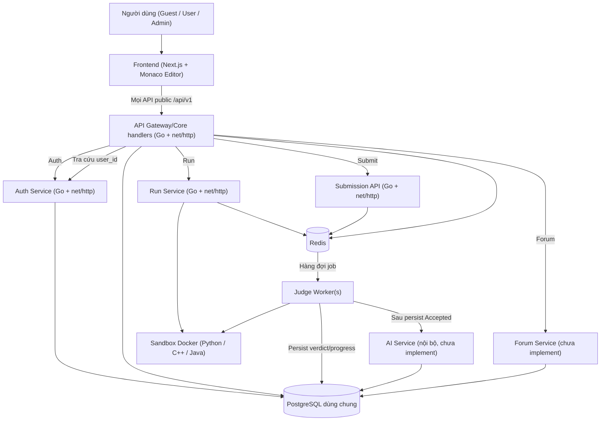
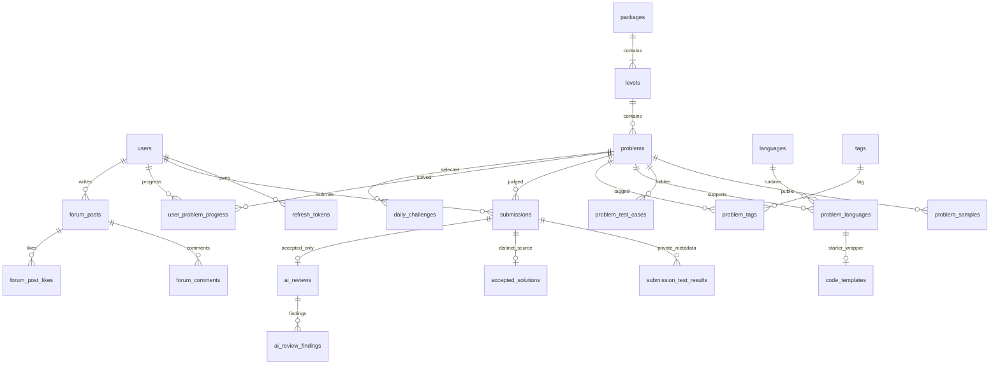
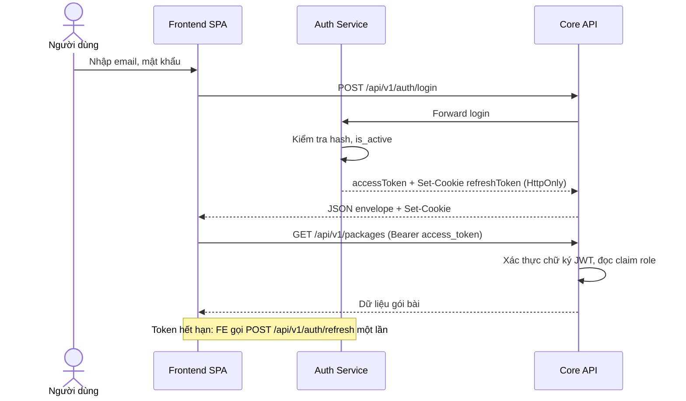
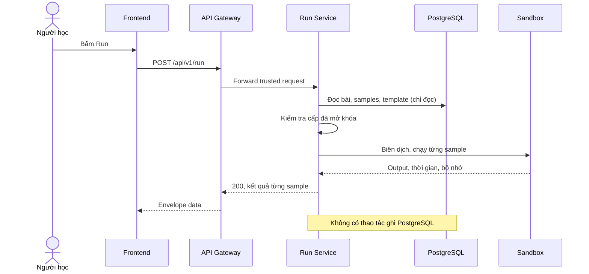
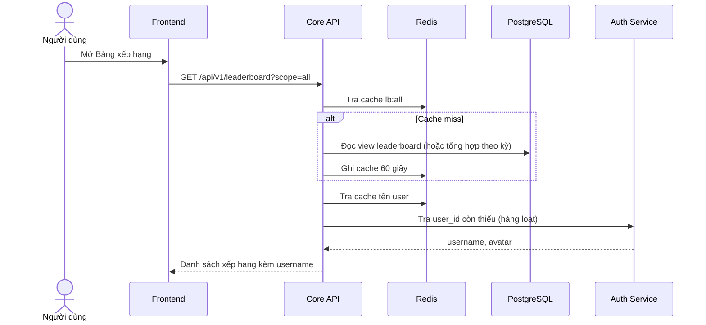
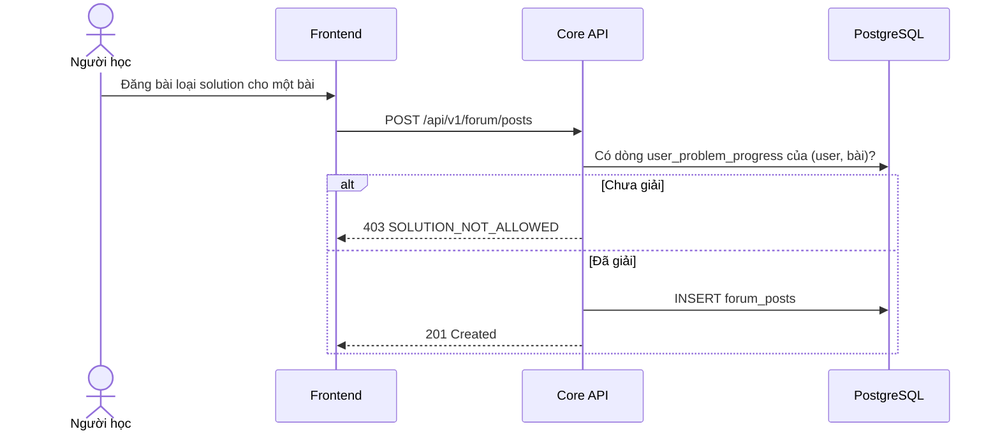

# TÀI LIỆU ĐẶC TẢ YÊU CẦU PHẦN MỀM (SRS)

## Dự án: Nền tảng Tự chấm code và Thực hành CNTT (Coding Judge Platform)

| | |
|---|---|
| **Phiên bản** | 2.1 |
| **Ngày cập nhật** | 07/11/2026 |
| **Trạng thái** | Contract đích cho mock frontend; chưa phải API live |
| **CSDL tham chiếu** | `schema.sql`: database độc lập, dùng chung, UUID; Go consumers chưa tích hợp |
| **Tài liệu liên quan** | `02_PHAN_CONG_NHIEM_VU.md` (phân công), `03_BACKLOG_THEO_SPRINT.md` (user story theo sprint) |

**Lịch sử thay đổi**

| Phiên bản | Nội dung |
|---|---|
| 2.1 | Hoàn thiện mock contract F01–F13, UUID schema dùng chung; bỏ DTO/SQL legacy khỏi contract; runtime chưa implement |
| 1.0 | Bản đầu tiên, mô hình dữ liệu tự đề xuất |
| 1.1 | Đồng bộ với `coding_judge_schema.sql` (chỉ lưu Accepted, Auth Service tách riêng) |
| 1.2 | Viết lại theo phong cách chuyên nghiệp: endpoint, JSON, SQL, sơ đồ Mermaid; đặc tả đủ 12 chức năng |
| 1.3 | Thêm mục thư viện dùng chung (2.5); tách phần phân công và backlog thành tài liệu riêng; thống nhất mã nhiệm vụ với bảng phân công |
| 1.5 | Chốt mục 8; Next.js + Go; quy tắc tích hợp và hạn nộp 22/11/2026 |
| 1.4 | Điều chỉnh phân công cho team 4 người (mục 6, mục 7); các mục chức năng và kỹ thuật không đổi |
| 2.0 | Đồng bộ backend cũ: giữ Run/Submit/Judge, bỏ Repository/GitHub, AI chỉ chạy sau Accepted, thêm Forum và API đích |

## 0. PHẠM VI HIỆU LỰC CỦA BẢN 2.1

Bản 2.1 đồng bộ contract mock với `schema.sql` và các quyết định đã chốt.
OpenAPI [đầy đủ](docs/openapi.yaml) và [learner](docs/openapi_fe.yaml) là nguồn duy
nhất cho path, request/response, lỗi và ví dụ; bảng bên dưới chỉ lập mục lục.
Tất cả `/api/v1` là target, không phải endpoint đã chạy. Các chi tiết transport
mới được ghi riêng trong [frontend contract](docs/FRONTEND_API_CONTRACT.md).
Các đoạn mô tả cũ về lưu chỉ Accepted, Repository/GitHub, Asynq hoặc API `/api/v1`
chỉ được xem là bản đề xuất nếu chưa được thay bằng quy tắc dưới đây.

- **Giữ nguyên cơ chế judge:** Run sample đồng bộ; Submit tạo Pending, đẩy Redis,
  worker chạy Piston và cập nhật verdict. Schema/query/DTO được thay để biểu diễn
  Package → Level → Problem, progress, leaderboard, forum và AI review.
- **Bỏ repo flow:** không tạo repository, commit, GitHub App/OAuth/webhook hay
  commit metadata. `repo_service` và các bảng GitHub đã được loại khỏi code/schema mới.
- **AI review:** worker gọi `ai_service` nội bộ chỉ sau khi đã ghi verdict `Accepted`.
  AI lưu điểm/nhận xét riêng, không sửa verdict và không tham gia leaderboard.
  Run, Wrong Answer, Compile Error và các verdict khác không gọi AI.
- **API status:** route hiện tại không có `/api/v1`; các route `/api/v1` trong SRS là
  hợp đồng đích, chỉ bật sau migration và contract test. Xem `docs/FRONTEND_API_CONTRACT.md`.
- **Lịch thực hiện:** 06/11/2026–22/11/2026; đóng tính năng cuối ngày 19/11,
  kiểm thử và sửa lỗi 20–21/11.

---

## 1. TỔNG QUAN (INTRODUCTION)

### 1.1 Mục đích (Purpose)

Tài liệu này đặc tả toàn bộ yêu cầu kỹ thuật, nghiệp vụ và kiến trúc của **Coding Judge Platform**, một nền tảng web cho phép người học luyện tập lập trình và kỹ năng CNTT theo mô hình tương tự HackerRank và LeetCode. Hệ thống chấm bài tự động trong môi trường cô lập (sandbox), theo dõi tiến độ, tự mở khóa cấp độ, xếp hạng người học và có diễn đàn trao đổi lời giải.

Tài liệu là cơ sở để phân chia công việc cho team phát triển (xem `02_PHAN_CONG_NHIEM_VU.md`).

### 1.2 Phạm vi (Scope)

- **Định danh và Phân quyền (Identity & Access Management):** Đăng ký, đăng nhập bằng JWT, phân quyền theo vai trò (Guest, User, Admin). Do Auth Service quản lý.
- **Danh mục Bài tập (Problem Catalog):** Gói bài theo chủ đề, bài theo cấp độ, chọn ngôn ngữ, code mẫu (starter code) theo từng ngôn ngữ.
- **Chạy thử (Run Code):** Chạy code với test mẫu (sample), không lưu kết quả vào cơ sở dữ liệu.
- **Chấm bài (Submit & Judging):** Chạy toàn bộ test ẩn trong sandbox Docker, trả verdict và giữ cơ chế lưu kết quả hiện tại; Accepted cập nhật tiến độ và là điều kiện gọi AI.
- **Tiến độ và Lên cấp (Progression & Level Up):** Theo dõi bài đã giải, tự mở khóa cấp kế tiếp.
- **Bảng xếp hạng (Leaderboard):** Xếp hạng theo số bài đã giải.
- **Cộng đồng (Community Forum):** `forum_service` độc lập quản lý bài chia sẻ code/lời giải, bình luận, thích và moderation.
- **AI code review:** Sau Accepted, đánh giá chất lượng code bất đồng bộ qua `ai_service`; điểm AI tách khỏi verdict và leaderboard.
- **Quản trị (Administration):** Admin quản lý người dùng, bài, gói bài, test, ngôn ngữ, diễn đàn.

**Ngoài phạm vi phiên bản 2.0:** thi đấu contest thời gian thực, thanh toán, ứng dụng mobile native, phát hiện đạo văn, chạy thử với input tùy chỉnh, bài SQL/Linux (cần mở rộng `execution_mode`, xem mục 8). Repository/GitHub cũng bị loại khỏi sản phẩm đích.

### 1.3 Đối tượng sử dụng tài liệu (Target Audience)

- **Đội phát triển (Developers):** Duy trì backend Go hiện tại, mở rộng schema/service boundaries, và tích hợp Frontend theo contract versioned.
- **Kiểm thử viên (QA):** Xây dựng test plan, kiểm thử tích hợp và bảo mật sandbox.
- **Product Owner / Scrum Master:** Quản lý backlog, nghiệm thu theo tiêu chí chấp nhận.
- **Giảng viên hướng dẫn:** Đánh giá phạm vi và chất lượng đặc tả.

### 1.4 Định nghĩa và viết tắt

| Thuật ngữ | Ý nghĩa |
|---|---|
| Pack (Gói bài) | Chủ đề bài tập, lưu ở bảng `packages`; không có hierarchy cũ |
| Level (Cấp độ) | Bảng `levels`: mỗi package có 3 cấp, `easy`=1, `medium`=2, `hard`=3; bài tham chiếu `level_id` |
| Sample | Test mẫu hiển thị công khai (`problem_samples`), dùng cho Run |
| Hidden test | Test ẩn (`problem_test_cases`), dùng cho Submit, không lộ ra API người học |
| Run | Chạy thử với sample, không ghi PostgreSQL |
| Submit | Chạy toàn bộ test ẩn đang active; giữ trạng thái/vận hành judge hiện tại, Accepted mới cập nhật progress và gọi AI |
| Verdict | AC, WA, TLE, MLE, RE, CE, IE (Accepted, Wrong Answer, Time Limit Exceeded, Memory Limit Exceeded, Runtime Error, Compile Error, Internal Error) |
| Sandbox | Container Docker cô lập để chạy mã không tin cậy |
| JWT | JSON Web Token |

### 1.5 Quy tắc nghiệp vụ cốt lõi (Core Business Rules)

Các quy tắc này lấy trực tiếp từ schema và là ràng buộc bắt buộc.

| Mã | Quy tắc |
|---|---|
| BR-01 | Run chỉ chạy sample và trả kết quả đồng bộ; không ghi kết quả vào PostgreSQL. |
| BR-02 | Submit chạy tất cả `problem_test_cases` có `is_active = TRUE`, theo `display_order`. |
| BR-03 | Submission giữ trạng thái Pending → Running → verdict cuối theo cơ chế hiện tại; Accepted mới cập nhật progress và đủ điều kiện gọi AI. |
| BR-04 | Mã Accepted trùng được nhận diện bằng `(user_id, problem_id, language_id, source_hash)`. `source_hash` là SHA-256 chữ thường của đúng chuỗi byte mã nguồn dùng để chấm. |
| BR-05 | Auth Service sở hữu users, credentials, roles, refresh tokens. Một PostgreSQL dùng chung, `user_id` là UUID có foreign key nội bộ; không tách Auth DB. |
| BR-06 | `accepted_count` chỉ tăng khi ghi nhận **mã Accepted mới**; không tăng khi xử lý lại job hoặc gặp mã trùng. |
| BR-07 | Không sửa/xóa test case sau khi bài đã `published`. |
| BR-08 | `problem_samples` và `problem_test_cases` không bao giờ được trả trực tiếp qua API người học (sample chỉ trả dạng đã lọc). |

---

## 2. KIẾN TRÚC HỆ THỐNG (SYSTEM ARCHITECTURE)

### 2.1 Sơ đồ kiến trúc



### 2.2 Công nghệ

| Thành phần | Công nghệ | Ghi chú |
|---|---|---|
| Frontend | Next.js App Router, TypeScript, Monaco Editor, Axios | Responsive, tiếng Việt |
| Backend | Go, `net/http`, pgx v5, `encoding/json` | Bám service và package hiện có; migration/query cập nhật theo schema đích |
| CSDL | PostgreSQL 16 (extension `pgcrypto`) | Một database dùng chung, FK nội bộ, schema mới UUID |
| Cache/Queue | Redis 7 | Kết quả Run, trạng thái job, rate limit, cache xếp hạng, cache tên user |
| Hàng đợi chấm | Redis list (`LPUSH`/`BRPOP`) | Giữ worker và semantics hiện tại |
| Sandbox | Docker (mỗi runtime một image) | Không mạng, giới hạn tài nguyên |
| Triển khai | Docker Compose, CI | Không có GitHub App/repository runtime trong sản phẩm đích |

### 2.3 Quy ước API chung

- `/api/v1`, camelCase, UUID, UTC RFC3339. [OpenAPI đầy đủ](docs/openapi.yaml)
  có 94 operation, gồm 52 operation admin; [learner](docs/openapi_fe.yaml) có42.
- Envelope thành công `{status,code,message,data}`; lỗi
  `{status,code,message,error,details}`. Code bằng HTTP status, error là chuỗi,
  details luôn có/nullable; message tiếng Anh; 204/HEAD không có body.
- Paginated payload dùng items/page/size/total. `page=1,size=20`, leaderboard
  size50; tối đa100. Các list nhỏ cố định dùng items không pagination.
- Malformed JSON400 BAD_REQUEST; semantic field validation400 VALIDATION_ERROR.
  Endpoint-specific language/comment checks422; level lock403, owner mismatch404,
  published judge edit409. Chi tiết và ví dụ nằm trong OpenAPI.
- Run/Submit nhận problemId,languageId,code (tối đa102400 UTF-8 bytes, không
  custom input). Run đồng bộ200; Submit Pending201. Không tạo runId/jobId.
- Access token lưu memory; refresh cookie HttpOnly với Path=/ cho root/v1,
  Secure production, Origin/CSRF policy theo deployment. Không gửi X-User-* từ FE.
- Contract không triển khai RS256 hay đổi thuật toán JWT hiện tại. Quyết định
  token/key rollout riêng; không đưa provider/model keys vào DTO công khai.
- Avatar/bio đã có cột nullable trong schema mới, Go runtime chưa tích hợp. Password reset vẫn cần token store/email.

### 2.4 Ma trận phân quyền

| Tài nguyên | Guest | User | Admin |
|---|---|---|---|
| Landing, leaderboard công khai | Xem | Xem | Xem |
| Danh sách bài, chi tiết bài | Không | Xem | Xem |
| Run / Submit | Không | Có | Có |
| Lịch sử nộp bài của mình | Không | Có | Có |
| Lịch sử nộp bài của người khác | Không | Không | Có |
| Diễn đàn (xem) | Xem | Xem | Xem |
| Diễn đàn (đăng, bình luận, thích) | Không | Có | Có |
| Quản trị (`/admin/*`) | Không | Không | Có |

### 2.5 Thư viện dùng chung (Shared Packages)

Các service dùng shared packages ở `shared/` theo cấu trúc repository. Không giả định có thư mục `packages/` hoặc dependency chưa cài.

| Package | Nội dung | Chủ sở hữu | Dùng bởi |
|---|---|---|---|
| `common-auth` | Go middleware xác thực JWT, đọc `role`, middleware `RequireAdmin` | TV1 — Quốc Thịnh | Core API, Run, Judge, Auth |
| `common-db` | Model/query và pgx pool/transaction theo codebase hiện có | TV3 — Hiếu | Gateway/Core, Run, Submission, Forum, AI |
| `common-levels` | Hàm `get_level_status(user_id, package_id)` và `is_level_unlocked(...)` (xem F08) | TV3 — Hiếu | Core API, Run, Judge |
| `common-errors` | Lớp lỗi và handler theo định dạng lỗi mục 2.3 | TV1 — Quốc Thịnh | Mọi service |

---

## 3. YÊU CẦU CHỨC NĂNG (FUNCTIONAL REQUIREMENTS)

Ưu tiên: **M** (Must), **S** (Should), **C** (Could).

---

### F01. Đăng ký / Đăng nhập / Phân quyền (Auth Service)

**Mô tả:** Tạo tài khoản, đăng nhập, cấp JWT, phân quyền theo vai trò. Auth sở hữu logic identity trong database dùng chung.

| Mã | Yêu cầu | Ưu tiên |
|---|---|---|
| FR-01.1 | Đăng ký bằng email, username, mật khẩu; email và username duy nhất (không phân biệt hoa thường) | M |
| FR-01.2 | Mật khẩu tối thiểu 8 ký tự, có chữ và số; lưu hash bcrypt/argon2 | M |
| FR-01.3 | Đăng nhập trả `access_token` (15 phút) trong JSON và `refresh_token` (7 ngày) qua cookie HttpOnly | M |
| FR-01.4 | Làm mới token bằng refresh token; đăng xuất thu hồi refresh token | M |
| FR-01.5 | Phân quyền User/Admin trong claim `role`; Gateway kiểm tra JWT và xác thực nội bộ theo boundary; không tự đổi HS256 thành RS256 | M |
| FR-01.6 | Khóa/mở khóa tài khoản (`is_active`); tài khoản bị khóa không đăng nhập được | M |
| FR-01.7 | Quên mật khẩu qua email (token một lần, hết hạn 30 phút) | S |
| FR-01.8 | Xem/sửa hồ sơ (avatar, bio), đổi mật khẩu | S |
| FR-01.9 | API nội bộ tra cứu hàng loạt `user_id` thành `username`, `avatar_url` cho các service khác | M |
| FR-01.10 | Giới hạn thử đăng nhập sai (5 lần/phút/IP) | S |

**Endpoint target:** mọi path dưới đây có prefix `/api/v1`. Schema và ví dụ nằm trong OpenAPI.

| Method | Path | Quyền | Ưu tiên |
|---|---|---|---|
| POST | `/api/v1/auth/register` | Public | Must |
| POST | `/api/v1/auth/login` | Public | Must |
| POST | `/api/v1/auth/refresh` | Refresh cookie | Must |
| POST | `/api/v1/auth/logout` | Public | Must |
| POST | `/api/v1/auth/forgot-password` | Public | Should |
| POST | `/api/v1/auth/reset-password` | Public | Should |
| GET | `/api/v1/users/me` | Bearer/Owner theo mô tả | Must |
| PATCH | `/api/v1/users/me` | Bearer/Owner theo mô tả | Should |
| PUT | `/api/v1/users/me/password` | Bearer/Owner theo mô tả | Should |

Password recovery và cập nhật hồ sơ là Should. Avatar/bio đã có cột schema nullable; password recovery vẫn cần token store/email. Go runtime chưa tích hợp. Public author không trả email. Logout204; clear cookie không tự hủy JWT đã phát hành.

---

### F02. Landing page

**Mô tả:** Trang giới thiệu cho khách, dẫn đến đăng ký/đăng nhập.

| Mã | Yêu cầu | Ưu tiên |
|---|---|---|
| FR-02.1 | Hiển thị giới thiệu hệ thống, ngôn ngữ hỗ trợ, các gói bài nổi bật | M |
| FR-02.2 | Nút **Đăng ký** và **Đăng nhập**; nếu đã đăng nhập thay bằng **Vào luyện tập** | M |
| FR-02.3 | Thống kê công khai: số bài `published`, số người dùng, tổng lượt giải, top 5 xếp hạng | S |
| FR-02.4 | Responsive (desktop, tablet, mobile); điểm Lighthouse hiệu năng ≥ 80 | M |

**Endpoint target:** mọi path dưới đây có prefix `/api/v1`. Schema và ví dụ nằm trong OpenAPI.

| Method | Path | Quyền | Ưu tiên |
|---|---|---|---|
| GET | `/api/v1/public/landing` | Public | Must |

---

### F03. Chọn ngôn ngữ

**Mô tả:** Người học chọn ngôn ngữ lập trình trước hoặc trong khi làm bài.

| Mã | Yêu cầu | Ưu tiên |
|---|---|---|
| FR-03.1 | Hiển thị danh sách `languages` có `is_active = TRUE` | M |
| FR-03.2 | Với mỗi bài, chỉ cho chọn ngôn ngữ nằm trong `problem_languages` của bài | M |
| FR-03.3 | Đổi ngôn ngữ thì nạp `starter_code` tương ứng của bài | M |
| FR-03.4 | Ghi nhớ ngôn ngữ ưa thích ở trình duyệt (localStorage, khóa `cjp.preferred_language`) | S |
| FR-03.5 | Cảnh báo khi đổi ngôn ngữ nếu code hiện tại chưa nộp/chưa lưu | S |
| FR-03.6 | Nếu ngôn ngữ ưa thích không được bài hỗ trợ, chọn ngôn ngữ đầu tiên trong danh sách của bài | M |

**Endpoint target:** mọi path dưới đây có prefix `/api/v1`. Schema và ví dụ nằm trong OpenAPI.

| Method | Path | Quyền | Ưu tiên |
|---|---|---|---|
| GET | `/api/v1/languages` | Public | Must |
| GET | `/api/v1/problems/{slug}/languages` | Bearer/Owner theo mô tả | Must |

---

### F04. Chọn gói bài tập

**Mô tả:** Bài chia theo gói (chủ đề) và theo cấp độ. Người học duyệt gói, xem tiến độ và chọn bài.

| Mã | Yêu cầu | Ưu tiên |
|---|---|---|
| FR-04.1 | Danh sách gói bài từ `packages`, sắp theo `display_order` | M |
| FR-04.2 | Trong mỗi gói, bài chia ba cấp theo `difficulty`; hiển thị tiến độ (đã giải/tổng) mỗi cấp | M |
| FR-04.3 | Chỉ hiển thị bài `status = published` | M |
| FR-04.4 | Lọc/tìm kiếm theo tên (`q`), tag, độ khó, trạng thái (đã giải/chưa) | S |
| FR-04.5 | Trang chi tiết bài: `statement_md` (gồm constraints), sample, `time_limit_ms`, `memory_limit_mb`, tag | M |
| FR-04.6 | Bài thuộc cấp chưa mở hiển thị biểu tượng khóa; API chi tiết bài trả 403 `LEVEL_LOCKED` | M |
| FR-04.7 | Thử thách hằng ngày (`daily_challenges`): hiển thị bài của ngày hiện tại | C |

**Endpoint target:** mọi path dưới đây có prefix `/api/v1`. Schema và ví dụ nằm trong OpenAPI.

| Method | Path | Quyền | Ưu tiên |
|---|---|---|---|
| GET | `/api/v1/tags` | Public | Should |
| GET | `/api/v1/packages` | Bearer/Owner theo mô tả | Must |
| GET | `/api/v1/packages/{slug}` | Bearer/Owner theo mô tả | Must |
| GET | `/api/v1/problems` | Bearer/Owner theo mô tả | Must |
| GET | `/api/v1/problems/{slug}` | Bearer/Owner theo mô tả | Must |
| GET | `/api/v1/problems/{slug}/samples` | Bearer/Owner theo mô tả | Must |
| GET | `/api/v1/daily-challenge` | Bearer/Owner theo mô tả | Could |
| PUT | `/api/v1/admin/daily-challenges` | Admin | Could |

Packages/levels thay categories/difficulty hierarchy cũ. Chỉ bài published thuộc package published; statementMd chứa constraints, sample tách riêng khỏi hidden tests.

---

### F05. Code mẫu (Starter code)

**Mô tả:** Mỗi bài có code mẫu riêng theo từng ngôn ngữ, giúp người học chỉ cần viết phần logic.

| Mã | Yêu cầu | Ưu tiên |
|---|---|---|
| FR-05.1 | Mỗi cặp (bài, ngôn ngữ) có đúng một `code_templates` (`starter_code`, `file_name`) | M |
| FR-05.2 | Monaco Editor: highlight cú pháp theo ngôn ngữ, tự thụt lề, đánh số dòng | M |
| FR-05.3 | Nút **Reset về code mẫu** | M |
| FR-05.4 | Tự lưu nháp theo (user, bài, ngôn ngữ) trong localStorage, khóa `cjp.draft.{user_id}.{problem}.{language}` | S |
| FR-05.5 | Bài `function`: starter code là chữ ký hàm theo `function_name`; `wrapper_code` do Judge ghép để đọc input và gọi hàm | M |
| FR-05.6 | `wrapper_code` **không** được trả ra client | M |

**Endpoint target:** mọi path dưới đây có prefix `/api/v1`. Schema và ví dụ nằm trong OpenAPI.

| Method | Path | Quyền | Ưu tiên |
|---|---|---|---|
| GET | `/api/v1/problems/{slug}/template` | Bearer/Owner theo mô tả | Must |

Template chỉ trả starterCode,fileName; languageId là UUID. Không trả wrapperCode hoặc executeCode.

---

### F06. Run code (chạy thử)

**Mô tả:** Chạy thử mã với toàn bộ test mẫu để người học kiểm tra nhanh. **Không lưu kết quả vào PostgreSQL** (BR-01).

| Mã | Yêu cầu | Ưu tiên |
|---|---|---|
| FR-06.1 | Chạy mã với tất cả `problem_samples` của bài, theo `display_order` | M |
| FR-06.2 | Trả cho từng sample: output thực tế, output kỳ vọng, thời gian, bộ nhớ, thông báo lỗi compile/runtime | M |
| FR-06.3 | Trả kết quả đồng bộ trong response; không tạo `run_id`, không ghi PostgreSQL. Redis chỉ là tùy chọn cache nội bộ, không phải API trạng thái | M |
| FR-06.4 | Rate limit 10 lần/phút/user; vượt trả 429 | M |
| FR-06.5 | Kiểm tra bài đã được mở khóa (cấp độ) trước khi chạy | M |
| FR-06.6 | Giới hạn code tối đa 102400 UTF-8 bytes; quá giới hạn trả413 REQUEST_TOO_LARGE | M |
| FR-06.7 | Run dùng đúng giới hạn thời gian/bộ nhớ của bài | M |

**Endpoint target:** mọi path dưới đây có prefix `/api/v1`. Schema và ví dụ nằm trong OpenAPI.

| Method | Path | Quyền | Ưu tiên |
|---|---|---|---|
| POST | `/api/v1/run` | Bearer/Owner theo mô tả | Must |

Verdict nghiệp vụ nằm trong data.status, kể cả Wrong Answer. Run không tạo submission hay AI; không cần polling.

---

### F07. Submit

**Mô tả:** Chạy toàn bộ test ẩn để chấm chính thức theo worker hiện tại. Submission giữ verdict cuối; chỉ **Accepted** cập nhật tiến độ và kích hoạt AI review (BR-03).

| Mã | Yêu cầu | Ưu tiên |
|---|---|---|
| FR-07.1 | Chạy tất cả `problem_test_cases` có `is_active = TRUE`, theo `display_order` | M |
| FR-07.2 | Chấm bất đồng bộ qua Redis list hiện tại; tạo submission Pending trước khi enqueue, worker cập nhật trạng thái và verdict trong PostgreSQL | M |
| FR-07.3 | Verdict khác AC: trả verdict và tổng số test qua/tổng; metadata test theo endpoint Could, không trả raw hidden data | M |
| FR-07.4 | Với mọi verdict cuối, cập nhật submission đã tạo Pending; source_hash được tính khi tạo Pending; chỉ Accepted mới cập nhật progress trong transaction | M |
| FR-07.5 | Khi Accepted mới: upsert `user_problem_progress` trong **cùng transaction**; verdict lỗi vẫn được lưu để quan sát judge | M |
| FR-07.6 | Nếu mã Accepted trùng theo policy/schema đích: giữ verdict AC, không tăng tiến độ; không thêm field duplicate vào DTO learner | M |
| FR-07.7 | Test ẩn chỉ hiện pass/fail; không lộ input/output của test ẩn | M |
| FR-07.8 | Cooldown nộp10 giây theo user/problem, theo schema hiện tại | M |
| FR-07.9 | Chặn Submit khi bài không `published` hoặc cấp chưa mở | M |
| FR-07.10 | Ghi chi tiết từng test cho submission AC vào `submission_test_results` | C |
| FR-07.11 | Lỗi nội bộ của Judge phải có trạng thái cuối hoặc recovery rõ ràng; không để submission kẹt Pending/Running | M |

**Endpoint target:** mọi path dưới đây có prefix `/api/v1`. Schema và ví dụ nằm trong OpenAPI.

| Method | Path | Quyền | Ưu tiên |
|---|---|---|---|
| POST | `/api/v1/submit` | Bearer/Owner theo mô tả | Must |
| GET | `/api/v1/submissions/{id}` | Bearer/Owner theo mô tả | Must |

Lưu mọi verdict; source hash theo byte UTF-8 nguyên bản. accepted_solutions unique user/problem/language/hash bảo đảm xử lý lại không tăng progress. Submit chỉ Pending; UI refresh levels sau terminal Accepted. Thất bại enqueue sau DB commit cần recovery cùng submission ID.

---

### F08. Level up

**Mô tả:** Khi người học hoàn thành mọi bài của cấp hiện tại trong một gói, hệ thống mở khóa cấp kế tiếp. Cấp cuối là bài tư duy nâng cao. Trạng thái mở khóa **được tính động** từ `user_problem_progress`, không lưu thêm bảng. Logic nằm trong package dùng chung `logic shared levels khi được triển khai (mục 2.5).

| Mã | Yêu cầu | Ưu tiên |
|---|---|---|
| FR-08.1 | Mỗi gói có đúng 3 record levels với difficulty tương ứng; mặc định chỉ Cấp 1 mở | M |
| FR-08.2 | Cấp N+1 mở khi user đã giải **mọi bài `published`** của cấp N trong cùng gói | M |
| FR-08.3 | Cấp không có bài `published` nào được coi như đã hoàn thành (không chặn cấp sau) | M |
| FR-08.4 | Server kiểm tra khóa ở các API: chi tiết bài, template, Run, Submit; không tin client | M |
| FR-08.5 | Sau lần giải đầu của một bài làm đủ cấp, FE tải lại levels sau polling Accepted để hiển thị hiệu ứng; không thêm field vào Submit Pending | S |
| FR-08.6 | Trang gói bài hiển thị cấp đã mở/khóa, tiến độ `solved/total` từng cấp | M |

**Endpoint target:** mọi path dưới đây có prefix `/api/v1`. Schema và ví dụ nằm trong OpenAPI.

| Method | Path | Quyền | Ưu tiên |
|---|---|---|---|
| GET | `/api/v1/packages/{slug}/levels` | Bearer/Owner theo mô tả | Must |

Kiểm tra tất cả cấp trước, cấp rỗng không chặn; thêm bài published có thể khóa lại. Backend enforce ở detail/template/Run/Submit; không tin cờ FE.

---

### F09. Lịch sử nộp bài

**Mô tả:** Người học xem lịch sử submission của mình theo verdict và xem lại code khi được phép. Accepted dùng cho progress/leaderboard; AI review đọc riêng từ submission Accepted.

| Mã | Yêu cầu | Ưu tiên |
|---|---|---|
| FR-09.1 | Danh sách submission của user: bài, ngôn ngữ, verdict, `runtime_ms`, `memory_kb`, `passed/total`, `submitted_at` | M |
| FR-09.2 | Lọc theo bài, ngôn ngữ; phân trang; sắp xếp `submitted_at` giảm dần | M |
| FR-09.3 | Xem lại `source_code` của một submission | M |
| FR-09.4 | Nút **Dùng lại code này** nạp mã vào editor | S |
| FR-09.5 | User chỉ xem submission của chính mình; Admin xem được tất cả | M |
| FR-09.6 | Hiển thị chi tiết từng test nếu có `submission_test_results` | C |

**Endpoint target:** mọi path dưới đây có prefix `/api/v1`. Schema và ví dụ nằm trong OpenAPI.

| Method | Path | Quyền | Ưu tiên |
|---|---|---|---|
| GET | `/api/v1/me/submissions` | Bearer/Owner theo mô tả | Must |
| GET | `/api/v1/submissions/{id}/test-results` | Bearer/Owner theo mô tả | Could |
| GET | `/api/v1/me/submissions/{problemId}/latest` | Bearer/Owner theo mô tả | Must |
| GET | `/api/v1/me/stats` | Bearer/Owner theo mô tả | Must |

Source chỉ ở detail của chủ/admin. Người khác404. Không trả per-hidden-test diagnostics/input/output; chỉ aggregate pass/total. Latest không có bài trả submission:null.

---

### F10. Bảng xếp hạng

**Mô tả:** Xếp hạng người học theo số bài đã giải. Hệ thống không có điểm số ở phiên bản 1.0.

| Mã | Yêu cầu | Ưu tiên |
|---|---|---|
| FR-10.1 | Xếp hạng toàn hệ thống theo `solved_problem_count` giảm dần, đồng số thì xét `accepted_solution_count`; đồng số liệu thì đồng hạng (`RANK()`) | M |
| FR-10.2 | Hiển thị hạng, username, avatar, số bài đã giải | M |
| FR-10.3 | Lọc theo tuần, tháng, tất cả; lọc theo gói bài | S |
| FR-10.4 | Hiển thị hạng của user hiện tại kể cả khi ngoài top | S |
| FR-10.5 | Cache Redis (TTL 60 giây), làm mới khi có AC mới; cache tên user 10 phút | S |
| FR-10.6 | Guest xem được bảng xếp hạng tất cả thời gian (top 50) | M |

**Endpoint target:** mọi path dưới đây có prefix `/api/v1`. Schema và ví dụ nằm trong OpenAPI.

| Method | Path | Quyền | Ưu tiên |
|---|---|---|---|
| GET | `/api/v1/leaderboard` | Optional Bearer | Must |
| GET | `/api/v1/leaderboard/me` | Bearer/Owner theo mô tả | Should |

RANK theo solved distinct rồi Accepted distinct, không có AI score. Scope UTC theo firstSolvedAt, không đếm AC event trong kỳ; all có period bounds null. Tuần/tháng/gói truy vấn qua problems→levels→packages.

---

### F11. Diễn đàn

**Mô tả:** Người học đăng bài chia sẻ code/lời giải, thảo luận, bình luận và thích bài viết.

| Mã | Yêu cầu | Ưu tiên |
|---|---|---|
| FR-11.1 | Tạo bài viết: `title`, `content_md` (Markdown), `code_snippet`, `post_type` (`discussion`, `question`, `solution`) | M |
| FR-11.2 | Gắn bài viết với một bài tập (`problem_id`) và một ngôn ngữ (`language_id`), cả hai tùy chọn | M |
| FR-11.3 | Sửa bài viết của mình; xóa mềm (`status = deleted`, `deleted_at`) | M |
| FR-11.4 | Bình luận bài viết, trả lời lồng một cấp (`parent_id`); sửa, xóa mềm bình luận của mình | M |
| FR-11.5 | Thích/bỏ thích bài viết; mỗi user một lần mỗi bài (khóa chính `post_id, user_id`) | M |
| FR-11.6 | Danh sách bài: lọc theo bài tập, loại, ngôn ngữ; sắp xếp mới nhất, nhiều like, nhiều lượt xem; tìm theo tiêu đề | S |
| FR-11.7 | Tăng `view_count` khi mở chi tiết bài (một lần mỗi user mỗi phiên, tránh tăng lặp) | S |
| FR-11.8 | **Chống spoiler:** chỉ cho đăng `post_type = solution` gắn một bài khi user đã có dòng `user_problem_progress` của bài đó | S |
| FR-11.9 | Người học chỉ thấy bài `status = published` | M |
| FR-11.10 | Render Markdown an toàn: escape HTML, chặn script (chống XSS) | M |

**Endpoint target:** mọi path dưới đây có prefix `/api/v1`. Schema và ví dụ nằm trong OpenAPI.

| Method | Path | Quyền | Ưu tiên |
|---|---|---|---|
| GET | `/api/v1/forum/posts` | Optional Bearer | Must |
| POST | `/api/v1/forum/posts` | Bearer/Owner theo mô tả | Must |
| GET | `/api/v1/forum/posts/{id}` | Optional Bearer | Must |
| PATCH | `/api/v1/forum/posts/{id}` | Bearer/Owner theo mô tả | Must |
| DELETE | `/api/v1/forum/posts/{id}` | Bearer/Owner theo mô tả | Must |
| GET | `/api/v1/forum/posts/{id}/comments` | Public | Must |
| POST | `/api/v1/forum/posts/{id}/comments` | Bearer/Owner theo mô tả | Must |
| PATCH | `/api/v1/forum/comments/{id}` | Bearer/Owner theo mô tả | Must |
| DELETE | `/api/v1/forum/comments/{id}` | Bearer/Owner theo mô tả | Must |
| PUT | `/api/v1/forum/posts/{id}/like` | Bearer/Owner theo mô tả | Must |
| DELETE | `/api/v1/forum/posts/{id}/like` | Bearer/Owner theo mô tả | Must |

Solution create cần Accepted cho problem; đọc solution public theo SRS. Replies một cấp, parent phải cùng post/root/live; invalid422. Xóa comment trả tombstone content:null; Markdown render an toàn. Like idempotent.

---

### F12. Quản trị (Admin)

**Mô tả:** Admin quản lý người dùng, nội dung bài tập và diễn đàn. Mọi endpoint yêu cầu `role = admin`.

| Mã | Yêu cầu | Ưu tiên |
|---|---|---|
| FR-12.1 | Quản lý user (xem, tìm kiếm, khóa/mở khóa, đổi vai trò) thực hiện qua Auth Service | M |
| FR-12.2 | CRUD gói bài (`packages`): tên, slug, mô tả, display_order; không parent_id | M |
| FR-12.3 | CRUD bài: nội dung, độ khó, `time_limit_ms`, `memory_limit_mb`, `execution_mode`, `function_name`, tag, danh mục | M |
| FR-12.4 | Vòng đời bài: `draft` → `published` → `archived`; kiểm tra điều kiện trước khi publish | M |
| FR-12.5 | CRUD `problem_samples` và `problem_test_cases` (input/output/order; hidden test có is_active, không execute_code/points) | M |
| FR-12.6 | Khóa sửa/xóa test case khi bài đã `published` (trả 409 `PROBLEM_PUBLISHED_LOCKED`) | M |
| FR-12.7 | Quản lý ngôn ngữ: CRUD `languages`; gán `problem_languages`; CRUD `code_templates` | M |
| FR-12.8 | CRUD `tags` và gán tag cho bài | S |
| FR-12.9 | Quản lý diễn đàn: ẩn/xóa bài viết; bình luận chỉ xóa mềm isDeleted | M |
| FR-12.10 | Xem toàn bộ submission và verdict (AI review chỉ đọc riêng từ Accepted) | S |
| FR-12.11 | Nhân bản bài (clone) sang bản nháp để sửa test thay vì sửa trực tiếp bài đã publish | S |
| FR-12.12 | Dashboard thống kê: số bài, số lượt giải, số user đã giải ít nhất một bài, bài giải nhiều nhất | C |
| FR-12.13 | Quản lý thử thách hằng ngày (`daily_challenges`) | C |

**Endpoint target:** mọi path dưới đây có prefix `/api/v1`. Schema và ví dụ nằm trong OpenAPI.

| Method | Path | Quyền | Ưu tiên |
|---|---|---|---|
| GET | `/api/v1/admin/users` | Admin | Must |
| GET | `/api/v1/admin/users/{id}` | Admin | Must |
| PATCH | `/api/v1/admin/users/{id}` | Admin | Must |
| GET | `/api/v1/admin/packages` | Admin | Must |
| POST | `/api/v1/admin/packages` | Admin | Must |
| GET | `/api/v1/admin/packages/{id}` | Admin | Must |
| PATCH | `/api/v1/admin/packages/{id}` | Admin | Must |
| DELETE | `/api/v1/admin/packages/{id}` | Admin | Must |
| POST | `/api/v1/admin/packages/{id}/publish` | Admin | Must |
| POST | `/api/v1/admin/packages/{id}/archive` | Admin | Must |
| GET | `/api/v1/admin/packages/{id}/levels` | Admin | Must |
| PATCH | `/api/v1/admin/levels/{id}` | Admin | Must |
| GET | `/api/v1/admin/problems` | Admin | Must |
| POST | `/api/v1/admin/problems` | Admin | Must |
| GET | `/api/v1/admin/problems/{id}` | Admin | Must |
| PATCH | `/api/v1/admin/problems/{id}` | Admin | Must |
| DELETE | `/api/v1/admin/problems/{id}` | Admin | Must |
| POST | `/api/v1/admin/problems/{id}/publish` | Admin | Must |
| POST | `/api/v1/admin/problems/{id}/archive` | Admin | Must |
| POST | `/api/v1/admin/problems/{id}/clone` | Admin | Should |
| GET | `/api/v1/admin/problems/{id}/tags` | Admin | Must |
| PUT | `/api/v1/admin/problems/{id}/tags` | Admin | Should |
| GET | `/api/v1/admin/problems/{id}/languages` | Admin | Must |
| PUT | `/api/v1/admin/problems/{id}/languages` | Admin | Must |
| GET | `/api/v1/admin/problems/{id}/templates/{languageId}` | Admin | Must |
| PUT | `/api/v1/admin/problems/{id}/templates/{languageId}` | Admin | Must |
| DELETE | `/api/v1/admin/problems/{id}/templates/{languageId}` | Admin | Must |
| GET | `/api/v1/admin/problems/{id}/samples` | Admin | Must |
| POST | `/api/v1/admin/problems/{id}/samples` | Admin | Must |
| PATCH | `/api/v1/admin/problems/{id}/samples/{itemId}` | Admin | Must |
| DELETE | `/api/v1/admin/problems/{id}/samples/{itemId}` | Admin | Must |
| GET | `/api/v1/admin/problems/{id}/test-cases` | Admin | Must |
| POST | `/api/v1/admin/problems/{id}/test-cases` | Admin | Must |
| PATCH | `/api/v1/admin/problems/{id}/test-cases/{itemId}` | Admin | Must |
| DELETE | `/api/v1/admin/problems/{id}/test-cases/{itemId}` | Admin | Must |
| GET | `/api/v1/admin/languages` | Admin | Must |
| POST | `/api/v1/admin/languages` | Admin | Must |
| GET | `/api/v1/admin/languages/{id}` | Admin | Must |
| PATCH | `/api/v1/admin/languages/{id}` | Admin | Must |
| GET | `/api/v1/admin/tags` | Admin | Should |
| POST | `/api/v1/admin/tags` | Admin | Should |
| PATCH | `/api/v1/admin/tags/{id}` | Admin | Should |
| DELETE | `/api/v1/admin/tags/{id}` | Admin | Should |
| GET | `/api/v1/admin/submissions` | Admin | Should |
| GET | `/api/v1/admin/forum/posts` | Admin | Must |
| GET | `/api/v1/admin/forum/posts/{id}` | Admin | Must |
| PATCH | `/api/v1/admin/forum/posts/{id}` | Admin | Must |
| GET | `/api/v1/admin/forum/posts/{id}/comments` | Admin | Must |
| PATCH | `/api/v1/admin/forum/comments/{id}` | Admin | Must |
| GET | `/api/v1/admin/stats` | Admin | Could |
| GET | `/api/v1/admin/daily-challenges` | Admin | Could |
| PUT | `/api/v1/admin/daily-challenges` | Admin | Could |

Tạo package đồng thời 3 level. Khóa samples/tests/templates/languages/judge config sau lần publish đầu, kể cả archive. Clone draft để đổi test. Language deactivate thay delete. Comment chỉ isDeleted, không có hidden status. Không có points/executeCode override.

---

### F13. AI code review sau Accepted

**Mô tả:** `ai_service` nhận submission đã có verdict `Accepted` từ worker qua

| Mã | Yêu cầu | Ưu tiên |
|---|---|---|
| FR-13.1 | Chỉ gọi AI sau khi transaction judge đã ghi `Accepted`; mỗi submission tối đa một review đang hoạt động | M |
| FR-13.2 | Lưu `status` (`queued`, `running`, `completed`, `failed`), score 0–100, summary, findings, model/prompt version và timestamps | M |
| FR-13.3 | Run và verdict khác Accepted không tạo AI review; AI lỗi không đổi verdict hoặc rank | M |
| FR-13.4 | Chủ submission/Admin xem review qua API; owner check bắt buộc | M |
| FR-13.5 | Service không gửi hidden test, secret, provider key hoặc GitHub/repository metadata cho model | M |

**Endpoint target:** mọi path dưới đây có prefix `/api/v1`. Schema và ví dụ nằm trong OpenAPI.

| Method | Path | Quyền | Ưu tiên |
|---|---|---|---|
| GET | `/api/v1/submissions/{id}/ai-review` | Bearer/Owner theo mô tả | Must |

AI chỉ sau persist Accepted. GET trước khi có review row trả200 review:null; non-Accepted409. queued/running/completed/failed đọc riêng, không đổi verdict/rank. Không public POST trigger/retry. Không trả model/prompt/provider identifiers; rubric keys động, policy provider/quota/retry chưa chốt.

---

## 4. YÊU CẦU PHI CHỨC NĂNG (NON-FUNCTIONAL REQUIREMENTS)

| Mã | Nhóm | Yêu cầu |
|---|---|---|
| NFR-01 | Hiệu năng | Trang thường tải < 2 giây; API không kể chấm bài phản hồi < 500 ms với 95% request |
| NFR-02 | Hiệu năng chấm | Bài tiêu chuẩn có kết quả < 10 giây; hỗ trợ tối thiểu 20 submission đồng thời; Run phản hồi < 5 giây |
| NFR-03 | Bảo mật sandbox | Không mạng, không root, giới hạn CPU/RAM/số process/dung lượng file, hệ thống file chỉ đọc (trừ thư mục tạm), seccomp, hủy container sau khi chấm |
| NFR-04 | Bảo mật web | Chống SQL Injection (tham số hóa), XSS (escape Markdown), CSRF, HTTPS, CORS chặt |
| NFR-05 | Bảo vệ test ẩn | `problem_test_cases` chỉ Judge Worker và API admin đọc; không bao giờ trả qua API người học |
| NFR-06 | Bảo mật dữ liệu | Hash mật khẩu, không log mật khẩu/token, validate input bằng Go request DTO và validator |
| NFR-07 | Độ tin cậy | Ghi verdict và progress theo transaction phù hợp schema đích; lỗi hạ tầng trả IE; AI failure là trạng thái riêng |
| NFR-08 | Toàn vẹn dữ liệu | Tuân thủ CHECK/UNIQUE/FK của schema; migration/query theo tool hiện có; giữ kiểu ID hiện tại trong giai đoạn chuyển tiếp |
| NFR-09 | Mở rộng | Judge Worker tách riêng và tăng số worker được; thêm ngôn ngữ bằng image Docker + một dòng `languages` |
| NFR-10 | Dễ dùng | Giao diện tiếng Việt, responsive, trình soạn code thân thiện |
| NFR-11 | Bảo trì | gofmt, go vet, golangci-lint, coverage backend ≥ 60%, tài liệu OpenAPI/Swagger mỗi service |
| NFR-12 | Tương thích | Chrome, Edge, Firefox, Safari bản mới |
| NFR-13 | Quan sát | Log có `request_id`; theo dõi độ dài hàng đợi và thời gian chấm |

---

## 5. THIẾT KẾ DỮ LIỆU VÀ LUỒNG NGHIỆP VỤ

### 5.1 Schema dùng chung hiện tại

`schema.sql` là nguồn thực thi: 22 bảng, UUID và FK nội bộ; không có DB Auth
riêng hoặc old-data migration. Go consumers chưa được tích hợp schema này.



`accepted_solutions` lưu mã Accepted distinct; mỗi lần thử vẫn là submission.
Leaderboard all-time có view; tuần/tháng/gói là query cần triển khai. Avatar/bio
đã có cột users nullable (2048/1000 ký tự); reset-token store chưa có. Queue Redis LPUSH/BRPOP giữ nguyên,
không Asynq. PostgreSQL bootstrap phá dữ liệu đích khi chạy, chỉ dùng DB riêng.

### 5.2 Luồng nghiệp vụ điển hình (Workflows)

#### 5.2.1 Đăng nhập và xác thực



#### 5.2.2 Run code



#### 5.2.3 Submit và ghi nhận Accepted

```mermaid
sequenceDiagram
    actor U as Người học
    participant FE as Frontend
    participant GW as API Gateway
    participant JA as Submission API
    participant RD as Redis
    participant WK as Judge Worker
    participant SB as Sandbox
    participant DB as PostgreSQL
    participant AI as AI Service (nội bộ)
    U->>FE: Bấm Submit
    FE->>GW: POST /api/v1/submit
    GW->>JA: Forward trusted request
    JA->>DB: Kiểm tra cooldown10s theo user/problem
    JA->>DB: Kiểm tra bài published, cấp đã mở
    JA->>DB: INSERT Pending và commit
    JA->>RD: LPUSH submission ID sau commit
    JA-->>GW: 201, submission UUID (Pending)
    GW-->>FE: Envelope data.submission
    WK->>RD: BRPOP job
    WK->>DB: Claim Running, claim timestamp
    WK->>DB: Đọc problem_test_cases active
    loop Từng test ẩn
        WK->>SB: Chạy mã với input
        SB-->>WK: Output, thời gian, bộ nhớ
    end
    WK->>DB: BEGIN; cập nhật verdict cuối
    alt Verdict Accepted
        WK->>WK: Tính SHA-256 mã nguồn
        WK->>DB: Insert/get Accepted solution, cập nhật progress idempotent
        WK->>DB: COMMIT
        WK->>AI: Gọi AI review nội bộ sau khi Accepted đã persist
    else Verdict khác Accepted
        WK->>DB: COMMIT verdict, không cập nhật progress
    end
    FE->>GW: GET /api/v1/submissions/{id}
    GW->>JA: Poll trusted owner request
    JA-->>GW: Verdict aggregate
    GW-->>FE: Submission data; AI đọc riêng
```

#### 5.2.4 Mở khóa cấp (Level up)

Sau poll nhận Accepted, FE gọi `GET /api/v1/packages/{slug}/levels`; Gateway
đọc progress, đếm bài published theo từng level và kiểm tra tất cả cấp trước.
FE so sánh trạng thái trước/sau để hiện hiệu ứng. Không có worker push trực
tiếp tới FE hay field level_up trong response Submit Pending. Cấp rỗng không
chặn; thêm bài published có thể khóa lại cấp sau.

#### 5.2.5 Bảng xếp hạng



#### 5.2.6 Đăng lời giải trên diễn đàn (chống spoiler)



---

## 6. PHÂN CHIA NHIỆM VỤ (TÓM TẮT)

Chi tiết từng nhiệm vụ, phụ thuộc, lộ trình sprint, quy tắc làm việc: xem **`02_PHAN_CONG_NHIEM_VU.md`**. User story theo sprint: xem **`03_BACKLOG_THEO_SPRINT.md`**.

*Giả định team 4 người, làm theo Scrum.*

| Thành viên | Vai trò Scrum | Phụ trách chính |
|---|---|---|
| TV1 — Quốc Thịnh | Product Owner | Auth Service (F01), Diễn đàn (F11, API và giao diện), admin user và kiểm duyệt diễn đàn, `common-auth`, `common-errors`, test plan |
| TV2 — Tùng | Scrum Master | Run Service, Judge API + Worker, sandbox (F06, F07), Leaderboard API (F10), AI trigger sau Accepted (F13), kiểm thử end-to-end |
| TV3 — Hiếu | Developer | Core API nội dung (F03, F04, F05, F08, F09, F12 nội dung), `common-db`, `common-levels`, kiểm thử bảo mật web |
| TV4 — Huy | Developer | Frontend (F02 và giao diện các chức năng, Admin UI), trừ trang Diễn đàn và Hồ sơ |

| Chức năng | TV1 — Quốc Thịnh | TV2 — Tùng | TV3 — Hiếu | TV4 — Huy |
|---|---|---|---|---|
| F01 Đăng ký / Đăng nhập | R | | | S |
| F02 Landing page | S | | S | R |
| F03 Chọn ngôn ngữ | | S | R | S |
| F04 Chọn gói bài | | | R | S |
| F05 Code mẫu | | S | R | S |
| F06 Run code | | R | S | S |
| F07 Submit | | R | S | S |
| F08 Level up | | S | R | S |
| F09 Lịch sử nộp bài | | | R | S |
| F10 Bảng xếp hạng | S | R | | S |
| F11 Diễn đàn | R | | | S |
| F13 AI review | S (policy) | R (trigger/integration) | S (persistence) | S (UI đọc kết quả) |
| F12 Quản trị | R (user, diễn đàn) | | R (nội dung) | R (UI) |

R = chịu trách nhiệm chính, S = hỗ trợ (TV4 hỗ trợ ở đây nghĩa là làm giao diện, trừ F11 là component dùng chung).

---

## 7. RỦI RO VÀ BIỆN PHÁP

| Rủi ro | Mức | Biện pháp |
|---|---|---|
| Sandbox bị khai thác | Cao | Docker không mạng, seccomp, giới hạn tài nguyên; kiểm thử tấn công; cân nhắc Judge0 làm phương án dự phòng |
| Judge là phần khó nhất, trễ tiến độ | Cao | Bắt đầu từ Sprint 1, làm Python trước, thêm ngôn ngữ dần |
| TV2 và TV4 quá tải | Cao | Theo dõi burndown mỗi sprint; TV1 đã nhận giao diện Diễn đàn và Hồ sơ; cắt phạm vi mức Could trước; nếu trễ ở Sprint 3 thì kéo dài thêm 1 sprint |
| Nhiều service làm tăng công DevOps | Trung | Docker Compose duy nhất; hợp đồng OpenAPI từ Sprint 0; có thể gộp Core API/Run/Judge API chung một codebase nếu cần |
| Phụ thuộc Auth khi hiển thị username | Trung | Tra cứu hàng loạt + cache Redis; username dự phòng khi Auth lỗi |
| Đổi schema và thêm AI/Forum trong thời gian ngắn | Cao | Giữ judge mechanics, chia migration theo boundary, contract test và đóng scope 19/11 |
| Thiếu bài để demo | Trung | Mỗi người soạn tối thiểu 6–8 bài từ Sprint 2 |
| Lệch tiến độ FE và BE | Trung | Mock API theo OpenAPI, tích hợp liên tục mỗi sprint |

---

## 8. QUYẾT ĐỊNH VÀ THỨ TỰ ƯU TIÊN

Quyết định chủ dự án trong DECISIONS.md và schema.sql có ưu tiên. Bảng dưới là tóm tắt đã đối chiếu; transport details mới nằm trong FRONTEND_API_CONTRACT.md, không được diễn giải là runtime đã hoàn thành.

| # | Quyết định hiện tại | Phương án thay thế (cần sửa schema) | Team chốt |
|---|---|---|---|
| 1 | packages → levels (1/easy,2/medium,3/hard) → problems | Đã có bảng levels; hơn3 cấp cần đổi schema/contract | Database mới độc lập dùng packages/levels; không migrate subjects/session/lesson. |
| 2 | Lưu mọi submission/verdict | Chỉ Accepted dùng cho progress/AI/leaderboard, không xóa bài sai | Giữ mọi verdict trong submission; Accepted mới dùng cho progress, AI và leaderboard. |
| 3 | Mở khóa cấp tính động; thêm bài mới có thể khóa lại cấp sau | Thêm bảng lưu `unlocked_at` theo (user, gói, cấp) | Tính động, không thêm bảng. Mở cấp N chỉ khi tất cả cấp trước hoàn thành; cấp rỗng không chặn. Chấp nhận khóa lại khi thêm bài. |
| 4 | Xếp hạng theo số bài giải, đồng số liệu thì đồng hạng | Thêm trường điểm cho bài và quy tắc đồng điểm theo thời gian | RANK theo số bài giảm dần, rồi tổng AC khác mã giảm dần; đồng số liệu đồng hạng. Không dùng points để xếp hạng. |
| 5 | Bài SQL/Linux ngoài v1.0 | Mở rộng CHECK của `execution_mode` và bổ sung loại Judge | SQL/Linux ngoài phạm vi hạn 22/11. Runtime bài nộp: Python 3.12, C++17, Java 17. |
| 6 | Bỏ Run với input tùy chỉnh (Run chỉ chạy sample) | Cho phép custom input, kết quả chỉ ở Redis, không ghi DB | Run chỉ sample đồng bộ, Redis cache tùy chọn, không custom input và không ghi PostgreSQL. |
| 7 | Nháp code và ngôn ngữ ưa thích lưu localStorage | Thêm bảng draft và cột ưa thích | localStorage theo user+bài+ngôn ngữ; không lưu token trong localStorage. Xóa/chuyển namespace nháp khi đổi tài khoản. |
| 8 | Không có rejudge ở v1.0 | Cần lưu bài sai và phiên bản test (`problem_test_case_sets`) | Không rejudge; khóa test sau lần publish đầu tiên, kể cả archived; clone draft để đổi bộ test. |
| 9 | Diễn đàn: chỉ like bài viết; không tag riêng, không báo cáo vi phạm | Thêm bảng like bình luận, tag bài viết, báo cáo | Like bài viết, bình luận một cấp; không like bình luận/tag riêng/report. Chống XSS bắt buộc. |
| 10 | Kiến trúc nhiều service (Auth, Core, Run, Judge) | Gộp thành modular monolith nếu team thiếu nhân lực vận hành | Giữ Auth/Gateway/Run/Submission Worker; thêm Forum và AI service theo boundary; không giữ Repo/GitHub service trong sản phẩm đích. |
| 11 | `daily_challenges` để mức Could (có trong schema, không có trong 12 chức năng gốc) | Bỏ nếu không cần | Daily challenge là Could, không cam kết trước 22/11; giữ bảng SQL, triển khai khi Must đã nghiệm thu. |

### 8.1 Stack và ranh giới triển khai

- Frontend: Next.js App Router + TypeScript; Monaco là Client Component, tải động không SSR. Landing có thể SSR; không cache chung dữ liệu người dùng/tiến độ.
- Backend: Go + `net/http`; pgx v5 và package dùng chung hiện có; request DTO/validator; OpenAPI là hợp đồng versioned. Không tự đổi stack chỉ vì tài liệu nguồn dùng tên khác.
- Go backend sở hữu nghiệp vụ. Next.js chỉ giao diện; client gọi Gateway `/api/v1` (có thể qua proxy cùng origin tới Gateway), không tự định tuyến đến từng service hay viết lại nghiệp vụ trong Server Actions/route handlers.
- Redis list queue hiện tại được giữ; worker có giới hạn thời gian, xử lý giao lại job idempotent. Lỗi hạ tầng hết retry trả IE, giải phóng cooldown cho phép user thử lại; lỗi bài nộp không retry.
- PostgreSQL 16, Redis 7, Docker Compose. Backend Go không thay đổi Python/C++/Java trong sandbox. API process không được quyền Docker socket; chỉ execution worker tin cậy dùng Docker, mã người học không thấy socket, secrets hay test khác.
- Một Go module ở gốc, shared packages dưới shared/; mỗi service có cmd và internal. common-* trong tài liệu là trách nhiệm logic, không yêu cầu tạo thư mục hay abstraction mới.
- JWT hiện tại HS256; RS256/JWKS chỉ thực hiện khi có quyết định/migration riêng, không do contract đổi prefix. Access token ở memory client; refresh token cookie HttpOnly/Secure/SameSite, rotation và revoke trong database dùng chung do Auth sở hữu logic. Refresh/logout kiểm tra Origin và CSRF; Axios refresh single-flight, retry tối đa một lần.
- Mật khẩu bcrypt. API service-to-service dùng service token riêng, không lấy access token người dùng làm quyền nội bộ; không commit secret.
- `schema.sql` đã mô hình Package/Level/progress/leaderboard/forum/AI review, không GitHub; Go DTO/query còn cần tích hợp UUID. Không để mỗi service tự migrate đồng thời.

### 8.2 Các điểm schema cần enforce ở backend

- Khóa test/sample/template/ngôn ngữ/execution_mode sau lần publish đầu tiên (published_at khác NULL), kể cả archived; chỉnh mô tả được nhưng không đổi nghĩa chấm. Clone bản mới để thay test.
- schema không khóa cấp hoặc giới hạn bình luận: common-levels enforce mọi endpoint liên quan; parent comment phải cùng bài, chưa bị xóa và là comment gốc.
- Schema không có execute_code/points; API từ chối field này. wrapper_code admin-trusted thuộc template bài/ngôn ngữ, không trả qua learner API.
- Hàm source_hash chỉ hash mã người dùng UTF-8 nguyên bản, không hash wrapper; lưu đúng source_code đó. Transaction AC và tiến độ theo unique constraint sẵn có, kiểm tra race bằng test.
- Bảng xếp hạng tuần/tháng giữ ngữ nghĩa SRS: bài được giải lần đầu trong kỳ, accepted_count là tổng của các bài đó; không gọi đây là số lượt AC xảy ra trong kỳ. Ranh giới kỳ UTC.
- AI review chạy sau Accepted, lưu tách khỏi bảng xếp hạng; không dùng score AI để xếp hạng.
- Runtime bị kill do timeout/OOM phải phân loại TLE/MLE trước RE; độ ưu tiên CE > RE > TLE > MLE > WA chỉ áp dụng sau phân loại từng test.

### 8.3 Phạm vi và hạn nộp

Hạn nộp 22/11/2026, đóng tính năng 19/11 21:00; 20–21/11 kiểm thử/sửa lỗi. Must bắt buộc; Should làm sau Must, Could ngoài cam kết. Lịch 11 tuần trong tài liệu cũ là tham chiếu phân rã, không phải lịch thực thi. Lịch thực thi xem 04_KE_HOACH_TICH_HOP.md. Chưa có số giờ làm/ngày nên cần báo rủi ro, không bảo đảm toàn phạm vi chỉ bằng việc rút ngắn lịch.

## 9. Nguồn contract và nghiệm thu mock

- Full Gateway/admin: [openapi.yaml](docs/openapi.yaml); learner: [openapi_fe.yaml](docs/openapi_fe.yaml).
- Hướng dẫn mock, HTTP mapping, schema gaps và compatibility: [Frontend contract](docs/FRONTEND_API_CONTRACT.md).
- Các operation có x-feature F01–F13, x-owner, x-priority và x-implementation-status.
  Có schema, request/response examples, pagination và trạng thái rỗng/lỗi.
- Mock validation không phải runtime contract test. Backend cần tích hợp UUID,
  route v1, ownership, publish guard và worker recovery trước khi bật live.
- Should/Could được mô tả đầy đủ để FE mock; không tự đưa vào cam kết hạn nộp.
