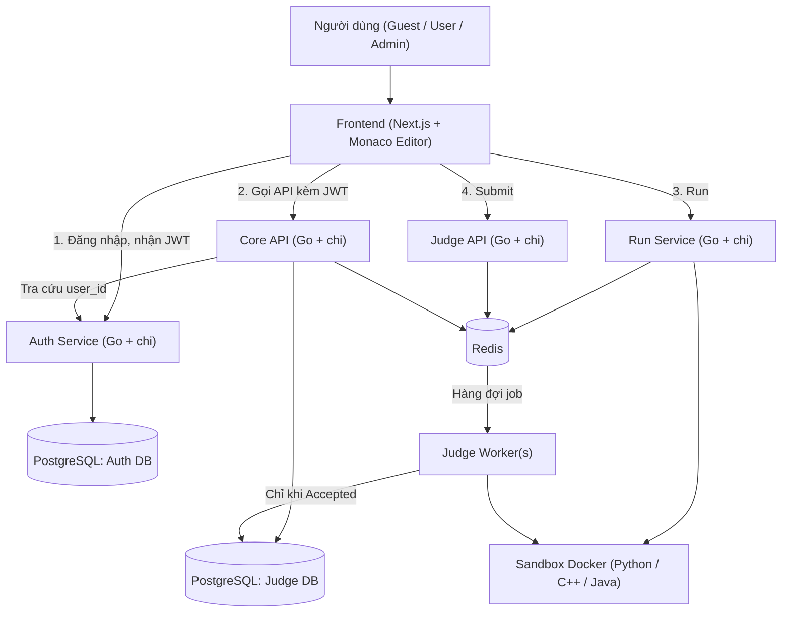
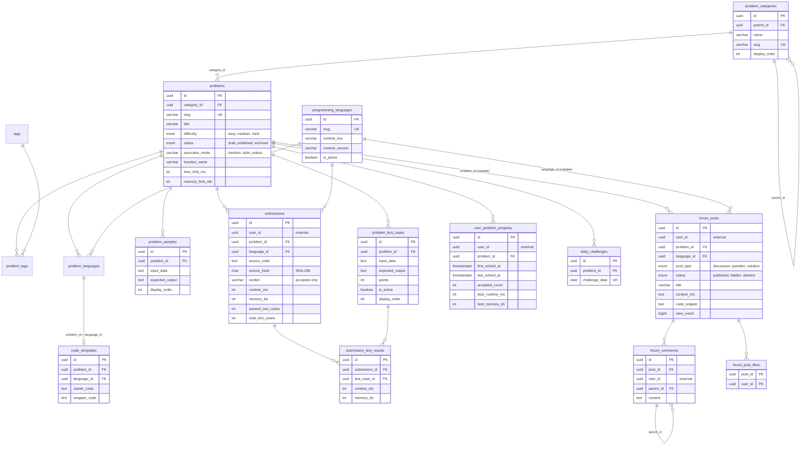
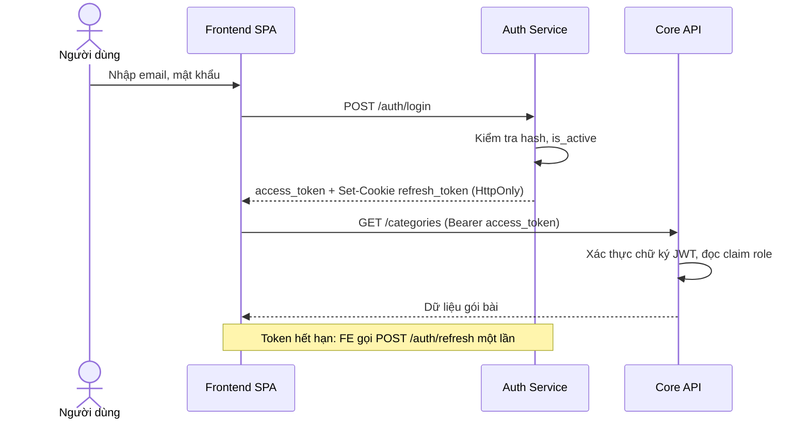
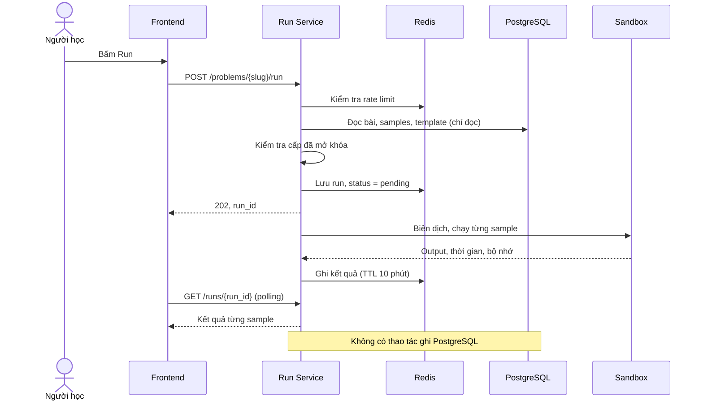
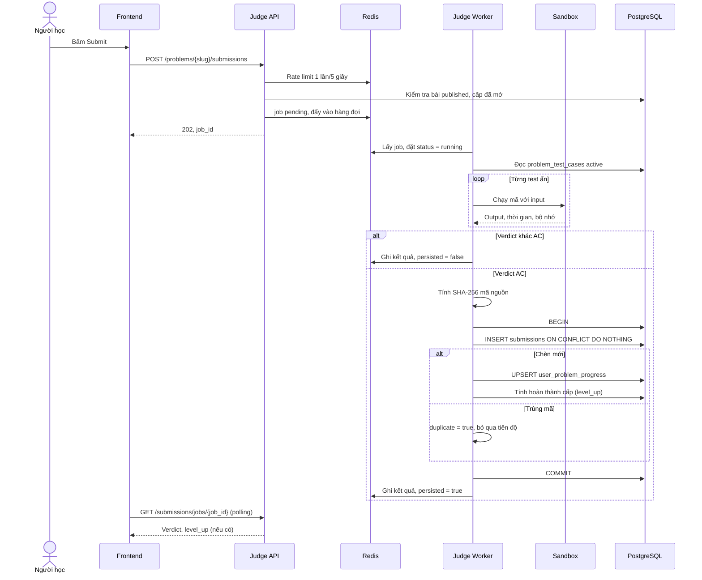
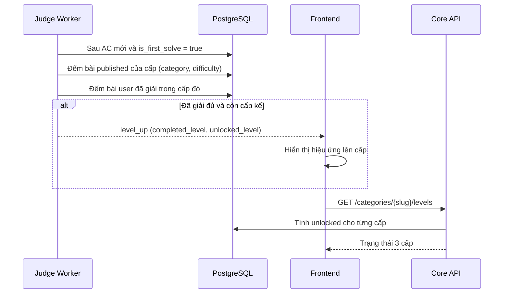
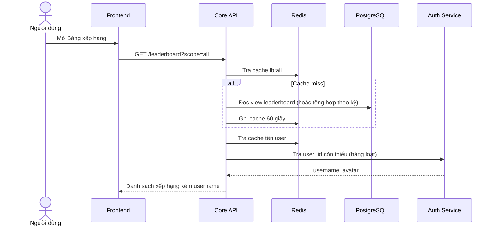
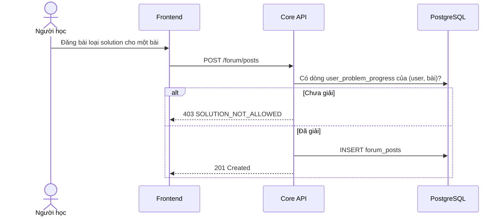

# TÀI LIỆU ĐẶC TẢ YÊU CẦU PHẦN MỀM (SRS)

## Dự án: Nền tảng Tự chấm code và Thực hành CNTT (Coding Judge Platform)

| | |
|---|---|
| **Phiên bản** | 1.5 |
| **Ngày cập nhật** | 04/11/2026 |
| **Trạng thái** | Bản thảo để team review |
| **CSDL tham chiếu** | `coding_judge_schema.sql` (PostgreSQL), giữ nguyên, SRS được viết cho khớp schema |
| **Tài liệu liên quan** | `02_PHAN_CONG_NHIEM_VU.md` (phân công), `03_BACKLOG_THEO_SPRINT.md` (user story theo sprint) |

**Lịch sử thay đổi**

| Phiên bản | Nội dung |
|---|---|
| 1.0 | Bản đầu tiên, mô hình dữ liệu tự đề xuất |
| 1.1 | Đồng bộ với `coding_judge_schema.sql` (chỉ lưu Accepted, Auth Service tách riêng) |
| 1.2 | Viết lại theo phong cách chuyên nghiệp: endpoint, JSON, SQL, sơ đồ Mermaid; đặc tả đủ 12 chức năng |
| 1.3 | Thêm mục thư viện dùng chung (2.5); tách phần phân công và backlog thành tài liệu riêng; thống nhất mã nhiệm vụ với bảng phân công |
| 1.5 | Chốt mục 8; Next.js + Go; quy tắc tích hợp và hạn nộp 22/11/2026 |
| 1.4 | Điều chỉnh phân công cho team 4 người (mục 6, mục 7); các mục chức năng và kỹ thuật không đổi |

---

## 1. TỔNG QUAN (INTRODUCTION)

### 1.1 Mục đích (Purpose)

Tài liệu này đặc tả toàn bộ yêu cầu kỹ thuật, nghiệp vụ và kiến trúc của **Coding Judge Platform**, một nền tảng web cho phép người học luyện tập lập trình và kỹ năng CNTT theo mô hình tương tự HackerRank và LeetCode. Hệ thống chấm bài tự động trong môi trường cô lập (sandbox), theo dõi tiến độ, tự mở khóa cấp độ, xếp hạng người học và có diễn đàn trao đổi lời giải.

Tài liệu là cơ sở để phân chia công việc cho team phát triển (xem `02_PHAN_CONG_NHIEM_VU.md`).

### 1.2 Phạm vi (Scope)

- **Định danh và Phân quyền (Identity & Access Management):** Đăng ký, đăng nhập bằng JWT, phân quyền theo vai trò (Guest, User, Admin). Do Auth Service quản lý.
- **Danh mục Bài tập (Problem Catalog):** Gói bài theo chủ đề, bài theo cấp độ, chọn ngôn ngữ, code mẫu (starter code) theo từng ngôn ngữ.
- **Chạy thử (Run Code):** Chạy code với test mẫu (sample), không lưu kết quả vào cơ sở dữ liệu.
- **Chấm bài (Submit & Judging):** Chạy toàn bộ test ẩn trong sandbox Docker, trả verdict, chỉ lưu bài đạt Accepted.
- **Tiến độ và Lên cấp (Progression & Level Up):** Theo dõi bài đã giải, tự mở khóa cấp kế tiếp.
- **Bảng xếp hạng (Leaderboard):** Xếp hạng theo số bài đã giải.
- **Cộng đồng (Community Forum):** Đăng bài chia sẻ code/lời giải, bình luận, thích.
- **Quản trị (Administration):** Admin quản lý người dùng, bài, gói bài, test, ngôn ngữ, diễn đàn.

**Ngoài phạm vi phiên bản 1.0:** thi đấu contest thời gian thực, thanh toán, ứng dụng mobile native, chấm bằng AI, phát hiện đạo văn, chạy thử với input tùy chỉnh, bài SQL/Linux (cần mở rộng `execution_mode`, xem mục 8).

### 1.3 Đối tượng sử dụng tài liệu (Target Audience)

- **Đội phát triển (Developers):** Triển khai Backend (Go + chi), Judge Engine, Frontend (Next.js + TypeScript).
- **Kiểm thử viên (QA):** Xây dựng test plan, kiểm thử tích hợp và bảo mật sandbox.
- **Product Owner / Scrum Master:** Quản lý backlog, nghiệm thu theo tiêu chí chấp nhận.
- **Giảng viên hướng dẫn:** Đánh giá phạm vi và chất lượng đặc tả.

### 1.4 Định nghĩa và viết tắt

| Thuật ngữ | Ý nghĩa |
|---|---|
| Pack (Gói bài) | Chủ đề bài tập (Mảng, Chuỗi, ...), lưu ở bảng `problem_categories` |
| Level (Cấp độ) | Ánh xạ từ `problems.difficulty`: `easy` = Cấp 1 (Cơ bản), `medium` = Cấp 2 (Trung bình), `hard` = Cấp 3 (Tư duy nâng cao) |
| Sample | Test mẫu hiển thị công khai (`problem_samples`), dùng cho Run |
| Hidden test | Test ẩn (`problem_test_cases`), dùng cho Submit, không lộ ra API người học |
| Run | Chạy thử với sample, không ghi PostgreSQL |
| Submit | Chạy toàn bộ test ẩn đang active, chỉ lưu khi Accepted |
| Verdict | AC, WA, TLE, MLE, RE, CE, IE (Accepted, Wrong Answer, Time Limit Exceeded, Memory Limit Exceeded, Runtime Error, Compile Error, Internal Error) |
| Sandbox | Container Docker cô lập để chạy mã không tin cậy |
| JWT | JSON Web Token |

### 1.5 Quy tắc nghiệp vụ cốt lõi (Core Business Rules)

Các quy tắc này lấy trực tiếp từ schema và là ràng buộc bắt buộc.

| Mã | Quy tắc |
|---|---|
| BR-01 | Run chỉ chạy `problem_samples`; kết quả lưu Redis có TTL; không ghi bất kỳ dòng nào vào PostgreSQL. |
| BR-02 | Submit chạy tất cả `problem_test_cases` có `is_active = TRUE`, theo `display_order`. |
| BR-03 | Chỉ submission **Accepted** được lưu. Verdict khác chỉ trả về client. |
| BR-04 | Mã Accepted trùng được nhận diện bằng `(user_id, problem_id, language_id, source_hash)`. `source_hash` là SHA-256 chữ thường của đúng chuỗi byte mã nguồn dùng để chấm. |
| BR-05 | Auth Service sở hữu users, credentials, roles, refresh tokens. Các cột `user_id` ở DB bài tập là UUID tham chiếu ngoài, **không có khóa ngoại liên service**. |
| BR-06 | `accepted_count` chỉ tăng khi **chèn mới** một dòng `submissions`; không tăng khi gặp xung đột (trùng mã). |
| BR-07 | Không sửa/xóa test case sau khi bài đã `published`. |
| BR-08 | `problem_samples` và `problem_test_cases` không bao giờ được trả trực tiếp qua API người học (sample chỉ trả dạng đã lọc). |

---

## 2. KIẾN TRÚC HỆ THỐNG (SYSTEM ARCHITECTURE)

### 2.1 Sơ đồ kiến trúc



### 2.2 Công nghệ

| Thành phần | Công nghệ | Ghi chú |
|---|---|---|
| Frontend | Next.js App Router, TypeScript, Monaco Editor, Axios | Responsive, tiếng Việt |
| Backend | Go, chi, pgx v5, sqlc, Goose, go-playground/validator | Mỗi service có OpenAPI riêng |
| CSDL | PostgreSQL 16 (extension `pgcrypto`) | Hai DB: Auth DB và Judge DB |
| Cache/Queue | Redis 7 | Kết quả Run, trạng thái job, rate limit, cache xếp hạng, cache tên user |
| Hàng đợi chấm | Asynq (Go) trên Redis | Tách riêng worker |
| Sandbox | Docker (mỗi runtime một image) | Không mạng, giới hạn tài nguyên |
| Triển khai | Docker Compose, GitHub Actions CI | |

### 2.3 Quy ước API chung

- Tiền tố: `/api/v1`. Định dạng JSON UTF-8. Thời gian ở dạng ISO-8601 UTC.
- Xác thực: header `Authorization: Bearer <access_token>`.
- Phân trang: `?page=1&size=20`; phản hồi chứa `items`, `page`, `size`, `total`.
- Định dạng lỗi thống nhất:

```json
{
  "error": {
    "code": "LEVEL_LOCKED",
    "message": "Bạn cần hoàn thành Cấp 1 của gói này trước.",
    "details": {}
  }
}
```

| HTTP | Mã lỗi (code) tiêu biểu |
|---|---|
| 400 / 422 | `VALIDATION_ERROR` |
| 401 | `UNAUTHORIZED`, `TOKEN_EXPIRED` |
| 403 | `FORBIDDEN`, `LEVEL_LOCKED`, `SOLUTION_NOT_ALLOWED` |
| 404 | `NOT_FOUND` |
| 409 | `CONFLICT`, `PROBLEM_PUBLISHED_LOCKED` |
| 413 | `PAYLOAD_TOO_LARGE` (mã nguồn tối đa 64 KB) |
| 429 | `RATE_LIMITED` (kèm header `Retry-After`) |

### 2.4 Ma trận phân quyền

| Tài nguyên | Guest | User | Admin |
|---|---|---|---|
| Landing, leaderboard công khai | Xem | Xem | Xem |
| Danh sách bài, chi tiết bài | Không | Xem | Xem |
| Run / Submit | Không | Có | Có |
| Lịch sử nộp bài của mình | Không | Có | Có |
| Lịch sử nộp bài của người khác | Không | Không | Có |
| Diễn đàn (xem) | Xem | Xem | Xem |
| Diễn đàn (đăng, bình luận, thích) | Không | Có | Có |
| Quản trị (`/admin/*`) | Không | Không | Có |

### 2.5 Thư viện dùng chung (Shared Packages)

Để các service không viết lặp và không lệch hành vi, repo có thư mục `packages/` dùng chung. Mỗi package có **một chủ sở hữu**; thay đổi phải qua Pull Request và báo các thành viên dùng package.

| Package | Nội dung | Chủ sở hữu | Dùng bởi |
|---|---|---|---|
| `common-auth` | Go middleware xác thực JWT, đọc `role`, middleware `RequireAdmin` | TV1 — Quốc Thịnh | Core API, Run, Judge, Auth |
| `common-db` | Kiểu dữ liệu và query sqlc cho Judge DB, pgx pool/transaction, migration SQL Goose | TV3 — Hiếu | Core API, Run, Judge |
| `common-levels` | Hàm `get_level_status(user_id, category_id)` và `is_level_unlocked(...)` (xem F08) | TV3 — Hiếu | Core API, Run, Judge |
| `common-errors` | Lớp lỗi và handler theo định dạng lỗi mục 2.3 | TV1 — Quốc Thịnh | Mọi service |

---

## 3. YÊU CẦU CHỨC NĂNG (FUNCTIONAL REQUIREMENTS)

Ưu tiên: **M** (Must), **S** (Should), **C** (Could).

---

### F01. Đăng ký / Đăng nhập / Phân quyền (Auth Service)

**Mô tả:** Tạo tài khoản, đăng nhập, cấp JWT, phân quyền theo vai trò. Toàn bộ dữ liệu người dùng nằm trong Auth DB.

| Mã | Yêu cầu | Ưu tiên |
|---|---|---|
| FR-01.1 | Đăng ký bằng email, username, mật khẩu; email và username duy nhất (không phân biệt hoa thường) | M |
| FR-01.2 | Mật khẩu tối thiểu 8 ký tự, có chữ và số; lưu hash bcrypt/argon2 | M |
| FR-01.3 | Đăng nhập trả `access_token` (15 phút) trong JSON và `refresh_token` (7 ngày) qua cookie HttpOnly | M |
| FR-01.4 | Làm mới token bằng refresh token; đăng xuất thu hồi refresh token | M |
| FR-01.5 | Phân quyền User/Admin trong claim `role`; mọi service tự kiểm tra JWT bằng khóa dùng chung/JWKS | M |
| FR-01.6 | Khóa/mở khóa tài khoản (`is_active`); tài khoản bị khóa không đăng nhập được | M |
| FR-01.7 | Quên mật khẩu qua email (token một lần, hết hạn 30 phút) | S |
| FR-01.8 | Xem/sửa hồ sơ (avatar, bio), đổi mật khẩu | S |
| FR-01.9 | API nội bộ tra cứu hàng loạt `user_id` thành `username`, `avatar_url` cho các service khác | M |
| FR-01.10 | Giới hạn thử đăng nhập sai (5 lần/phút/IP) | S |

**Endpoints (Auth Service):**

| Method | Đường dẫn | Mô tả | Quyền |
|---|---|---|---|
| POST | `/api/v1/auth/register` | Đăng ký | Public |
| POST | `/api/v1/auth/login` | Đăng nhập | Public |
| POST | `/api/v1/auth/refresh` | Làm mới access token | Public (refresh token) |
| POST | `/api/v1/auth/logout` | Thu hồi refresh token | User |
| POST | `/api/v1/auth/forgot-password` | Gửi email đặt lại mật khẩu | Public |
| POST | `/api/v1/auth/reset-password` | Đặt lại mật khẩu bằng token | Public |
| GET | `/api/v1/users/me` | Hồ sơ của tôi | User |
| PATCH | `/api/v1/users/me` | Sửa hồ sơ | User |
| PUT | `/api/v1/users/me/password` | Đổi mật khẩu | User |
| GET | `/internal/users?ids=u1,u2` | Tra cứu hàng loạt (service-to-service) | Service token |
| GET | `/api/v1/admin/users` | Danh sách, tìm kiếm user | Admin |
| PATCH | `/api/v1/admin/users/{id}` | Khóa/mở khóa, đổi vai trò | Admin |

**Ví dụ đăng ký:**

```json
// POST /api/v1/auth/register
{ "email": "an@example.com", "username": "an_nguyen", "password": "Matkhau123" }

// 201 Created
{ "id": "0b8c7f3e-...-9a1d", "email": "an@example.com", "username": "an_nguyen", "role": "user" }
```

**Ví dụ đăng nhập:**

```json
// POST /api/v1/auth/login
{ "email": "an@example.com", "password": "Matkhau123" }

// 200 OK
{
  "access_token": "eyJhbGciOi...",
  "token_type": "bearer",
  "expires_in": 900,
  "user": { "id": "0b8c7f3e-...-9a1d", "username": "an_nguyen", "role": "user" }
}
```

**Claims của JWT:** `sub` (user id), `role`, `iat`, `exp`.

**Tiêu chí chấp nhận:** đăng ký trùng email/username trả 409; sai mật khẩu trả 401 với thông báo chung; user thường gọi `/admin/*` nhận 403; access token hết hạn trả `TOKEN_EXPIRED`, FE tự refresh một lần rồi mới yêu cầu đăng nhập lại.

---

### F02. Landing page

**Mô tả:** Trang giới thiệu cho khách, dẫn đến đăng ký/đăng nhập.

| Mã | Yêu cầu | Ưu tiên |
|---|---|---|
| FR-02.1 | Hiển thị giới thiệu hệ thống, ngôn ngữ hỗ trợ, các gói bài nổi bật | M |
| FR-02.2 | Nút **Đăng ký** và **Đăng nhập**; nếu đã đăng nhập thay bằng **Vào luyện tập** | M |
| FR-02.3 | Thống kê công khai: số bài `published`, số người dùng, tổng lượt giải, top 5 xếp hạng | S |
| FR-02.4 | Responsive (desktop, tablet, mobile); điểm Lighthouse hiệu năng ≥ 80 | M |

| Method | Đường dẫn | Mô tả | Quyền |
|---|---|---|---|
| GET | `/api/v1/public/landing` | Thống kê, gói bài nổi bật, ngôn ngữ, top 5 | Public |

```json
// 200 OK
{
  "stats": { "problems": 36, "users": 1280, "accepted_submissions": 9421 },
  "languages": [ { "slug": "python3", "name": "Python 3" }, { "slug": "cpp17", "name": "C++17" }, { "slug": "java17", "name": "Java 17" } ],
  "featured_categories": [ { "slug": "arrays", "name": "Mảng", "problem_count": 12 } ],
  "top_users": [ { "rank": 1, "username": "an_nguyen", "solved": 34 } ]
}
```

`users` lấy từ Auth Service (API nội bộ), kết quả cache Redis 5 phút.

---

### F03. Chọn ngôn ngữ

**Mô tả:** Người học chọn ngôn ngữ lập trình trước hoặc trong khi làm bài.

| Mã | Yêu cầu | Ưu tiên |
|---|---|---|
| FR-03.1 | Hiển thị danh sách `programming_languages` có `is_active = TRUE` | M |
| FR-03.2 | Với mỗi bài, chỉ cho chọn ngôn ngữ nằm trong `problem_languages` của bài | M |
| FR-03.3 | Đổi ngôn ngữ thì nạp `starter_code` tương ứng của bài | M |
| FR-03.4 | Ghi nhớ ngôn ngữ ưa thích ở trình duyệt (localStorage, khóa `cjp.preferred_language`) | S |
| FR-03.5 | Cảnh báo khi đổi ngôn ngữ nếu code hiện tại chưa nộp/chưa lưu | S |
| FR-03.6 | Nếu ngôn ngữ ưa thích không được bài hỗ trợ, chọn ngôn ngữ đầu tiên trong danh sách của bài | M |

| Method | Đường dẫn | Mô tả | Quyền |
|---|---|---|---|
| GET | `/api/v1/languages` | Danh sách ngôn ngữ đang hoạt động | Public |
| GET | `/api/v1/problems/{slug}/languages` | Ngôn ngữ mà bài hỗ trợ | User |

```json
// GET /api/v1/languages  -> 200 OK
[
  { "id": "7c1e...", "slug": "python3", "name": "Python 3", "runtime_version": "3.12", "file_extension": ".py" },
  { "id": "9a2b...", "slug": "cpp17",   "name": "C++17",    "runtime_version": "gcc-13", "file_extension": ".cpp" },
  { "id": "b410...", "slug": "java17",  "name": "Java 17",  "runtime_version": "17",     "file_extension": ".java" }
]
```

`runtime_key` không trả ra client (chỉ dùng nội bộ cho Judge).

---

### F04. Chọn gói bài tập

**Mô tả:** Bài chia theo gói (chủ đề) và theo cấp độ. Người học duyệt gói, xem tiến độ và chọn bài.

| Mã | Yêu cầu | Ưu tiên |
|---|---|---|
| FR-04.1 | Danh sách gói bài từ `problem_categories`, sắp theo `display_order` | M |
| FR-04.2 | Trong mỗi gói, bài chia ba cấp theo `difficulty`; hiển thị tiến độ (đã giải/tổng) mỗi cấp | M |
| FR-04.3 | Chỉ hiển thị bài `status = published` | M |
| FR-04.4 | Lọc/tìm kiếm theo tên (`q`), tag, độ khó, trạng thái (đã giải/chưa) | S |
| FR-04.5 | Trang chi tiết bài: `description_md`, `constraints_md`, sample, `time_limit_ms`, `memory_limit_mb`, tag | M |
| FR-04.6 | Bài thuộc cấp chưa mở hiển thị biểu tượng khóa; API chi tiết bài trả 403 `LEVEL_LOCKED` | M |
| FR-04.7 | Thử thách hằng ngày (`daily_challenges`): hiển thị bài của ngày hiện tại | C |

**Lưu ý thiết kế:** bài published phải thuộc đúng một `category_id` hợp lệ (schema cho phép NULL, API phải kiểm tra khi publish; không xóa category còn bài). `parent_id` của `problem_categories` chỉ dùng để nhóm hiển thị; tiến độ cấp độ tính theo từng category chứa bài.

| Method | Đường dẫn | Mô tả | Quyền |
|---|---|---|---|
| GET | `/api/v1/categories` | Danh sách gói bài kèm tổng số bài | User |
| GET | `/api/v1/categories/{slug}` | Chi tiết gói, 3 cấp, trạng thái khóa, tiến độ | User |
| GET | `/api/v1/problems` | Danh sách bài có lọc, phân trang | User |
| GET | `/api/v1/problems/{slug}` | Chi tiết bài (kiểm tra khóa cấp) | User |
| GET | `/api/v1/daily-challenge` | Bài của ngày | User |

**Tham số `GET /problems`:** `category`, `difficulty` (`easy|medium|hard`), `tag`, `solved` (`true|false`), `q`, `page`, `size`.

```json
// GET /api/v1/problems/two-sum  -> 200 OK
{
  "slug": "two-sum",
  "title": "Tổng hai số",
  "difficulty": "easy",
  "category": { "slug": "arrays", "name": "Mảng" },
  "description_md": "Cho mảng số nguyên ...",
  "constraints_md": "1 <= n <= 10^5",
  "time_limit_ms": 1000,
  "memory_limit_mb": 128,
  "execution_mode": "function",
  "tags": ["array", "hash-table"],
  "samples": [ { "input": "[2,7,11,15]\n9", "expected_output": "[0,1]" } ],
  "languages": ["python3", "cpp17", "java17"],
  "solved": false
}
```

---

### F05. Code mẫu (Starter code)

**Mô tả:** Mỗi bài có code mẫu riêng theo từng ngôn ngữ, giúp người học chỉ cần viết phần logic.

| Mã | Yêu cầu | Ưu tiên |
|---|---|---|
| FR-05.1 | Mỗi cặp (bài, ngôn ngữ) có đúng một `code_templates` (`starter_code`, `file_name`) | M |
| FR-05.2 | Monaco Editor: highlight cú pháp theo ngôn ngữ, tự thụt lề, đánh số dòng | M |
| FR-05.3 | Nút **Reset về code mẫu** | M |
| FR-05.4 | Tự lưu nháp theo (user, bài, ngôn ngữ) trong localStorage, khóa `cjp.draft.{user_id}.{problem}.{language}` | S |
| FR-05.5 | Bài `function`: starter code là chữ ký hàm theo `function_name`; `wrapper_code` do Judge ghép để đọc input và gọi hàm | M |
| FR-05.6 | `wrapper_code` **không** được trả ra client | M |

| Method | Đường dẫn | Mô tả | Quyền |
|---|---|---|---|
| GET | `/api/v1/problems/{slug}/template?language=python3` | Starter code theo ngôn ngữ | User |

```json
// 200 OK
{
  "language": "python3",
  "file_name": "solution.py",
  "starter_code": "def two_sum(nums, target):\n    # Viết lời giải ở đây\n    pass\n"
}
```

**Cách chấm bài `function`:** Judge ghép `wrapper_code` + mã người học, đọc `input_data`, gọi hàm `function_name`, in kết quả ra stdout để so với `expected_output`. Với `stdin_stdout`, Judge chạy mã nguyên bản, cấp `input_data` qua stdin.

---

### F06. Run code (chạy thử)

**Mô tả:** Chạy thử mã với toàn bộ test mẫu để người học kiểm tra nhanh. **Không lưu kết quả vào PostgreSQL** (BR-01).

| Mã | Yêu cầu | Ưu tiên |
|---|---|---|
| FR-06.1 | Chạy mã với tất cả `problem_samples` của bài, theo `display_order` | M |
| FR-06.2 | Trả cho từng sample: output thực tế, output kỳ vọng, thời gian, bộ nhớ, thông báo lỗi compile/runtime | M |
| FR-06.3 | Lưu kết quả vào Redis (`run:{run_id}`, TTL 10 phút); không ghi PostgreSQL | M |
| FR-06.4 | Rate limit 10 lần/phút/user; vượt trả 429 | M |
| FR-06.5 | Kiểm tra bài đã được mở khóa (cấp độ) trước khi chạy | M |
| FR-06.6 | Giới hạn kích thước mã nguồn 64 KB; mã vượt giới hạn trả 413 | M |
| FR-06.7 | Run dùng đúng giới hạn thời gian/bộ nhớ của bài | M |

| Method | Đường dẫn | Mô tả | Quyền |
|---|---|---|---|
| POST | `/api/v1/problems/{slug}/run` | Tạo lượt Run, trả `run_id` | User |
| GET | `/api/v1/runs/{run_id}` | Lấy trạng thái/kết quả Run | User (chủ lượt Run) |

```json
// POST /api/v1/problems/two-sum/run
{ "language": "python3", "source_code": "def two_sum(nums, target):\n    ..." }

// 202 Accepted
{ "run_id": "r_8f3a1c", "status": "pending" }
```

```json
// GET /api/v1/runs/r_8f3a1c  -> 200 OK
{
  "run_id": "r_8f3a1c",
  "status": "done",
  "verdict": "wrong_answer",
  "compile_output": null,
  "results": [
    { "index": 1, "passed": true,  "actual_output": "[0,1]", "expected_output": "[0,1]", "runtime_ms": 14, "memory_kb": 9120 },
    { "index": 2, "passed": false, "actual_output": "[1,2]", "expected_output": "[0,2]", "runtime_ms": 15, "memory_kb": 9100 }
  ]
}
```

`status`: `pending` → `running` → `done`. Client dùng polling `GET /runs/{id}` để đồng nhất cách xử lý.

---

### F07. Submit

**Mô tả:** Chạy toàn bộ test ẩn để chấm chính thức. Chỉ khi **Accepted**, hệ thống lưu submission và cập nhật tiến độ (BR-03).

| Mã | Yêu cầu | Ưu tiên |
|---|---|---|
| FR-07.1 | Chạy tất cả `problem_test_cases` có `is_active = TRUE`, theo `display_order` | M |
| FR-07.2 | Chấm bất đồng bộ qua hàng đợi; trạng thái job lưu Redis: `pending` → `running` → `done` | M |
| FR-07.3 | Verdict khác AC: trả verdict, số test qua, số thứ tự test sai đầu tiên; **không lưu DB** | M |
| FR-07.4 | Verdict AC: tính `source_hash` (SHA-256), ghi `submissions` bằng `INSERT ... ON CONFLICT` | M |
| FR-07.5 | Nếu chèn mới: upsert `user_problem_progress` trong **cùng transaction** | M |
| FR-07.6 | Nếu trùng mã Accepted: trả AC, `duplicate = true`, không tăng `accepted_count` | M |
| FR-07.7 | Test ẩn chỉ hiện pass/fail; không lộ input/output của test ẩn | M |
| FR-07.8 | Rate limit nộp 1 lần/5 giây/user | M |
| FR-07.9 | Chặn Submit khi bài không `published` hoặc cấp chưa mở | M |
| FR-07.10 | Ghi chi tiết từng test cho submission AC vào `submission_test_results` | C |
| FR-07.11 | Lỗi nội bộ của Judge trả IE, không ghi DB, user nộp lại được | M |

**Bảng verdict:**

| Giá trị API | Viết tắt | Điều kiện |
|---|---|---|
| `accepted` | AC | Mọi test active đều đúng |
| `wrong_answer` | WA | Output sai ở ít nhất một test |
| `time_limit_exceeded` | TLE | Vượt `time_limit_ms` |
| `memory_limit_exceeded` | MLE | Vượt `memory_limit_mb` |
| `runtime_error` | RE | Mã thoát khác 0, bị kill, output quá 1 MB |
| `compile_error` | CE | Biên dịch thất bại |
| `internal_error` | IE | Lỗi hạ tầng chấm |

**Quy tắc so sánh output:** bỏ khoảng trắng cuối mỗi dòng và dòng trống cuối file; phân biệt hoa thường. Mức ưu tiên verdict khi nhiều test lỗi: CE > RE > TLE > MLE > WA.

| Method | Đường dẫn | Mô tả | Quyền |
|---|---|---|---|
| POST | `/api/v1/problems/{slug}/submissions` | Nộp bài, trả `job_id` | User |
| GET | `/api/v1/submissions/jobs/{job_id}` | Trạng thái và kết quả chấm | User (chủ job) |

```json
// POST /api/v1/problems/two-sum/submissions
{ "language": "python3", "source_code": "def two_sum(nums, target):\n    ..." }

// 202 Accepted
{ "job_id": "j_41c9e2", "status": "pending" }
```

```json
// GET /api/v1/submissions/jobs/j_41c9e2  -> Wrong Answer (không lưu DB)
{
  "job_id": "j_41c9e2",
  "status": "done",
  "verdict": "wrong_answer",
  "passed_test_cases": 7,
  "total_test_cases": 12,
  "failed_test_index": 8,
  "message": null,
  "persisted": false
}
```

```json
// Accepted lần đầu
{
  "job_id": "j_41c9f0",
  "status": "done",
  "verdict": "accepted",
  "runtime_ms": 38,
  "memory_kb": 10480,
  "passed_test_cases": 12,
  "total_test_cases": 12,
  "persisted": true,
  "duplicate": false,
  "submission_id": "5d0e...",
  "first_solve": true,
  "level_up": { "category_slug": "arrays", "completed_level": 1, "unlocked_level": 2 }
}
```

**Tính `source_hash`:**

```go
// import "crypto/sha256" và "encoding/hex"
sum := sha256.Sum256([]byte(sourceCode))
sourceHash := hex.EncodeToString(sum[:]) // UTF-8 nguyên bản, không trim/normalize
```

**Ghi submission Accepted (idempotent):**

```sql
INSERT INTO submissions
  (user_id, problem_id, language_id, source_code, source_hash,
   runtime_ms, memory_kb, passed_test_cases, total_test_cases)
VALUES ($1, $2, $3, $4, $5, $6, $7, $8, $9)
ON CONFLICT ON CONSTRAINT uq_submission_accepted_code DO NOTHING
RETURNING id;
```

Nếu `RETURNING` có dòng: là lần AC mới, tiếp tục upsert tiến độ. Nếu không có dòng: là mã trùng, kết thúc với `duplicate = true`.

**Cập nhật tiến độ (cùng transaction):**

```sql
INSERT INTO user_problem_progress
  (user_id, problem_id, best_runtime_ms, best_memory_kb)
VALUES ($1, $2, $3, $4)
ON CONFLICT (user_id, problem_id) DO UPDATE SET
  accepted_count  = user_problem_progress.accepted_count + 1,
  last_solved_at  = CURRENT_TIMESTAMP,
  best_runtime_ms = LEAST(user_problem_progress.best_runtime_ms, EXCLUDED.best_runtime_ms),
  best_memory_kb  = LEAST(user_problem_progress.best_memory_kb,  EXCLUDED.best_memory_kb)
RETURNING (xmax = 0) AS is_first_solve;
```

`is_first_solve = true` khi dòng vừa được tạo mới. (`LEAST` của PostgreSQL bỏ qua giá trị NULL.)

---

### F08. Level up

**Mô tả:** Khi người học hoàn thành mọi bài của cấp hiện tại trong một gói, hệ thống mở khóa cấp kế tiếp. Cấp cuối là bài tư duy nâng cao. Trạng thái mở khóa **được tính động** từ `user_problem_progress`, không lưu thêm bảng. Logic nằm trong package dùng chung `common-levels` (mục 2.5).

| Cấp | `difficulty` | Tên hiển thị |
|---|---|---|
| 1 | `easy` | Cơ bản |
| 2 | `medium` | Trung bình |
| 3 | `hard` | Tư duy nâng cao |

| Mã | Yêu cầu | Ưu tiên |
|---|---|---|
| FR-08.1 | Mỗi gói có tối đa 3 cấp theo `difficulty`; mặc định chỉ Cấp 1 mở | M |
| FR-08.2 | Cấp N+1 mở khi user đã giải **mọi bài `published`** của cấp N trong cùng gói | M |
| FR-08.3 | Cấp không có bài `published` nào được coi như đã hoàn thành (không chặn cấp sau) | M |
| FR-08.4 | Server kiểm tra khóa ở các API: chi tiết bài, template, Run, Submit; không tin client | M |
| FR-08.5 | Sau lần giải đầu của một bài làm đủ cấp, Submit trả `level_up` để FE hiển thị hiệu ứng | S |
| FR-08.6 | Trang gói bài hiển thị cấp đã mở/khóa, tiến độ `solved/total` từng cấp | M |

| Method | Đường dẫn | Mô tả | Quyền |
|---|---|---|---|
| GET | `/api/v1/categories/{slug}/levels` | Trạng thái 3 cấp của gói với user hiện tại | User |

```json
// 200 OK
{
  "category": "arrays",
  "levels": [
    { "level": 1, "difficulty": "easy",   "name": "Cơ bản",           "total": 5, "solved": 5, "unlocked": true,  "completed": true },
    { "level": 2, "difficulty": "medium", "name": "Trung bình",       "total": 4, "solved": 1, "unlocked": true,  "completed": false },
    { "level": 3, "difficulty": "hard",   "name": "Tư duy nâng cao",  "total": 3, "solved": 0, "unlocked": false, "completed": false }
  ]
}
```

**Truy vấn tính tiến độ một cấp:**

```sql
SELECT COUNT(p.id)  AS total,
       COUNT(upp.id) AS solved
FROM problems p
LEFT JOIN user_problem_progress upp
       ON upp.problem_id = p.id AND upp.user_id = $1
WHERE p.category_id = $2
  AND p.difficulty  = $3
  AND p.status      = 'published';
```

**Quy tắc mở khóa:** cấp `easy` luôn mở; cấp `medium` mở khi `total = solved` của `easy` (hoặc `total = 0`); cấp `hard` mở khi cả `easy` và `medium` hoàn thành. Luôn xét tất cả cấp trước để cấp rỗng không cho phép vượt cấp chưa giải.

**Hạn chế đã biết:** vì tính động, nếu Admin thêm bài `published` mới vào cấp đã hoàn thành thì cấp sau của user có thể bị khóa lại. Giải pháp thay thế (bảng lưu trạng thái mở khóa) nằm ở mục 8.

---

### F09. Lịch sử nộp bài

**Mô tả:** Người học xem lại các lần nộp **Accepted** của mình, xem lại code. Các lần nộp lỗi chỉ hiển thị trong phiên làm bài hiện tại (BR-03).

| Mã | Yêu cầu | Ưu tiên |
|---|---|---|
| FR-09.1 | Danh sách submission của user: bài, ngôn ngữ, verdict (luôn `accepted`), `runtime_ms`, `memory_kb`, `passed/total`, `submitted_at` | M |
| FR-09.2 | Lọc theo bài, ngôn ngữ; phân trang; sắp xếp `submitted_at` giảm dần | M |
| FR-09.3 | Xem lại `source_code` của một submission | M |
| FR-09.4 | Nút **Dùng lại code này** nạp mã vào editor | S |
| FR-09.5 | User chỉ xem submission của chính mình; Admin xem được tất cả | M |
| FR-09.6 | Hiển thị chi tiết từng test nếu có `submission_test_results` | C |

| Method | Đường dẫn | Mô tả | Quyền |
|---|---|---|---|
| GET | `/api/v1/me/submissions` | Lịch sử Accepted của tôi | User |
| GET | `/api/v1/submissions/{id}` | Chi tiết một submission (kèm code) | Chủ sở hữu, Admin |
| GET | `/api/v1/admin/submissions` | Mọi submission, lọc theo user/bài | Admin |

Tham số `GET /me/submissions`: `problem`, `language`, `page`, `size`.

```json
// 200 OK
{
  "items": [
    {
      "id": "5d0e...",
      "problem": { "slug": "two-sum", "title": "Tổng hai số" },
      "language": "python3",
      "verdict": "accepted",
      "runtime_ms": 38,
      "memory_kb": 10480,
      "passed_test_cases": 12,
      "total_test_cases": 12,
      "submitted_at": "2026-11-01T09:12:44Z"
    }
  ],
  "page": 1, "size": 20, "total": 1
}
```

Truy cập submission của người khác bởi user thường trả 404 (không tiết lộ sự tồn tại).

---

### F10. Bảng xếp hạng

**Mô tả:** Xếp hạng người học theo số bài đã giải. Hệ thống không có điểm số ở phiên bản 1.0.

| Mã | Yêu cầu | Ưu tiên |
|---|---|---|
| FR-10.1 | Xếp hạng toàn hệ thống theo `solved_problem_count` giảm dần, đồng số thì xét `accepted_solution_count`; đồng số liệu thì đồng hạng (`RANK()`) | M |
| FR-10.2 | Hiển thị hạng, username, avatar, số bài đã giải | M |
| FR-10.3 | Lọc theo tuần, tháng, tất cả; lọc theo gói bài | S |
| FR-10.4 | Hiển thị hạng của user hiện tại kể cả khi ngoài top | S |
| FR-10.5 | Cache Redis (TTL 60 giây), làm mới khi có AC mới; cache tên user 10 phút | S |
| FR-10.6 | Guest xem được bảng xếp hạng tất cả thời gian (top 50) | M |

| Method | Đường dẫn | Mô tả | Quyền |
|---|---|---|---|
| GET | `/api/v1/leaderboard` | Bảng xếp hạng | Public (scope `all`), User (các scope khác) |
| GET | `/api/v1/leaderboard/me` | Hạng của tôi | User |

Tham số: `scope` (`all|week|month`), `category`, `page`, `size`.

```json
// 200 OK
{
  "scope": "all",
  "items": [
    { "rank": 1, "user_id": "0b8c...", "username": "an_nguyen", "avatar_url": null, "solved_problem_count": 34, "accepted_solution_count": 41 },
    { "rank": 2, "user_id": "77f2...", "username": "binh_tran", "avatar_url": null, "solved_problem_count": 31, "accepted_solution_count": 33 }
  ],
  "page": 1, "size": 50, "total": 1280
}
```

**Scope `all`:** đọc view `leaderboard`.

```sql
SELECT user_id, solved_problem_count, accepted_solution_count, rank
FROM leaderboard
ORDER BY rank, user_id
LIMIT $1 OFFSET $2;
```

**Scope `week`, `month` hoặc lọc gói bài:** tổng hợp trực tiếp từ `user_problem_progress` theo `first_solved_at`.

```sql
SELECT upp.user_id,
       COUNT(*)                         AS solved_problem_count,
       SUM(upp.accepted_count)          AS accepted_solution_count,
       RANK() OVER (ORDER BY COUNT(*) DESC, SUM(upp.accepted_count) DESC) AS rank
FROM user_problem_progress upp
JOIN problems p ON p.id = upp.problem_id
WHERE upp.first_solved_at >= date_trunc('week', CURRENT_TIMESTAMP)   -- hoặc 'month'
  AND ($1::uuid IS NULL OR p.category_id = $1)
GROUP BY upp.user_id
ORDER BY rank, upp.user_id
LIMIT $2 OFFSET $3;
```

**Gắn tên người dùng:** Core API lấy danh sách `user_id` của trang, tra cache Redis (`user:{id}`), phần thiếu gọi `/internal/users?ids=...` của Auth Service rồi ghi cache. Nếu Auth không phản hồi, hiển thị username dự phòng `user_<8 ký tự đầu của id>`.

---

### F11. Diễn đàn

**Mô tả:** Người học đăng bài chia sẻ code/lời giải, thảo luận, bình luận và thích bài viết.

| Mã | Yêu cầu | Ưu tiên |
|---|---|---|
| FR-11.1 | Tạo bài viết: `title`, `content_md` (Markdown), `code_snippet`, `post_type` (`discussion`, `question`, `solution`) | M |
| FR-11.2 | Gắn bài viết với một bài tập (`problem_id`) và một ngôn ngữ (`language_id`), cả hai tùy chọn | M |
| FR-11.3 | Sửa bài viết của mình; xóa mềm (`status = deleted`, `deleted_at`) | M |
| FR-11.4 | Bình luận bài viết, trả lời lồng một cấp (`parent_id`); sửa, xóa mềm bình luận của mình | M |
| FR-11.5 | Thích/bỏ thích bài viết; mỗi user một lần mỗi bài (khóa chính `post_id, user_id`) | M |
| FR-11.6 | Danh sách bài: lọc theo bài tập, loại, ngôn ngữ; sắp xếp mới nhất, nhiều like, nhiều lượt xem; tìm theo tiêu đề | S |
| FR-11.7 | Tăng `view_count` khi mở chi tiết bài (một lần mỗi user mỗi phiên, tránh tăng lặp) | S |
| FR-11.8 | **Chống spoiler:** chỉ cho đăng `post_type = solution` gắn một bài khi user đã có dòng `user_problem_progress` của bài đó | S |
| FR-11.9 | Người học chỉ thấy bài `status = published` | M |
| FR-11.10 | Render Markdown an toàn: escape HTML, chặn script (chống XSS) | M |

| Method | Đường dẫn | Mô tả | Quyền |
|---|---|---|---|
| GET | `/api/v1/forum/posts` | Danh sách bài viết | Public |
| POST | `/api/v1/forum/posts` | Tạo bài viết | User |
| GET | `/api/v1/forum/posts/{id}` | Chi tiết bài viết | Public |
| PATCH | `/api/v1/forum/posts/{id}` | Sửa bài (chủ bài) | User |
| DELETE | `/api/v1/forum/posts/{id}` | Xóa mềm (chủ bài) | User |
| GET | `/api/v1/forum/posts/{id}/comments` | Danh sách bình luận | Public |
| POST | `/api/v1/forum/posts/{id}/comments` | Thêm bình luận/trả lời | User |
| PATCH | `/api/v1/forum/comments/{id}` | Sửa bình luận | User |
| DELETE | `/api/v1/forum/comments/{id}` | Xóa mềm bình luận | User |
| PUT | `/api/v1/forum/posts/{id}/like` | Thích bài | User |
| DELETE | `/api/v1/forum/posts/{id}/like` | Bỏ thích | User |

```json
// POST /api/v1/forum/posts
{
  "post_type": "solution",
  "problem_slug": "two-sum",
  "language": "python3",
  "title": "Giải Two Sum bằng hash map O(n)",
  "content_md": "Dùng dict lưu giá trị đã duyệt ...",
  "code_snippet": "def two_sum(nums, target):\n    seen = {}\n    ..."
}

// 201 Created
{ "id": "a91c...", "status": "published", "like_count": 0, "view_count": 0, "created_at": "2026-11-01T10:05:00Z" }
```

```json
// POST /api/v1/forum/posts/a91c.../comments
{ "content": "Cách này hay, cảm ơn bạn!", "parent_id": null }
```

Nếu `post_type = solution` và user chưa giải bài: `403 SOLUTION_NOT_ALLOWED`. Nếu `parent_id` trỏ tới bình luận đã là bình luận con: `422` (chỉ cho lồng một cấp). `like_count` tính bằng `COUNT(*)` trên `forum_post_likes` (có thể cache).

---

### F12. Quản trị (Admin)

**Mô tả:** Admin quản lý người dùng, nội dung bài tập và diễn đàn. Mọi endpoint yêu cầu `role = admin`.

| Mã | Yêu cầu | Ưu tiên |
|---|---|---|
| FR-12.1 | Quản lý user (xem, tìm kiếm, khóa/mở khóa, đổi vai trò) thực hiện qua Auth Service | M |
| FR-12.2 | CRUD gói bài (`problem_categories`): tên, slug, mô tả, `parent_id`, `display_order` | M |
| FR-12.3 | CRUD bài: nội dung, độ khó, `time_limit_ms`, `memory_limit_mb`, `execution_mode`, `function_name`, tag, danh mục | M |
| FR-12.4 | Vòng đời bài: `draft` → `published` → `archived`; kiểm tra điều kiện trước khi publish | M |
| FR-12.5 | CRUD `problem_samples` và `problem_test_cases` (`input_data`, `expected_output`, `execute_code`, `points`, `display_order`, `is_active`) | M |
| FR-12.6 | Khóa sửa/xóa test case khi bài đã `published` (trả 409 `PROBLEM_PUBLISHED_LOCKED`) | M |
| FR-12.7 | Quản lý ngôn ngữ: CRUD `programming_languages`; gán `problem_languages`; CRUD `code_templates` | M |
| FR-12.8 | CRUD `tags` và gán tag cho bài | S |
| FR-12.9 | Quản lý diễn đàn: ẩn (`hidden`) hoặc xóa bài viết, bình luận vi phạm | M |
| FR-12.10 | Xem toàn bộ submission Accepted | S |
| FR-12.11 | Nhân bản bài (clone) sang bản nháp để sửa test thay vì sửa trực tiếp bài đã publish | S |
| FR-12.12 | Dashboard thống kê: số bài, số lượt giải, số user đã giải ít nhất một bài, bài giải nhiều nhất | C |
| FR-12.13 | Quản lý thử thách hằng ngày (`daily_challenges`) | C |

**Điều kiện publish một bài:** có category hợp lệ; bài function có function_name và wrapper phù hợp từng ngôn ngữ; có ít nhất 1 sample, ít nhất 1 test ẩn `is_active`, ít nhất 1 ngôn ngữ trong `problem_languages`, và mỗi ngôn ngữ đều có `code_templates`.

| Method | Đường dẫn | Mô tả |
|---|---|---|
| GET/POST | `/api/v1/admin/categories` | Liệt kê, tạo gói bài |
| PATCH/DELETE | `/api/v1/admin/categories/{id}` | Sửa, xóa gói bài |
| GET/POST | `/api/v1/admin/problems` | Liệt kê (mọi trạng thái), tạo bài |
| GET/PATCH | `/api/v1/admin/problems/{id}` | Xem, sửa bài |
| POST | `/api/v1/admin/problems/{id}/publish` | Publish (có kiểm tra điều kiện) |
| POST | `/api/v1/admin/problems/{id}/archive` | Lưu trữ |
| POST | `/api/v1/admin/problems/{id}/clone` | Nhân bản thành bản nháp |
| PUT | `/api/v1/admin/problems/{id}/tags` | Gán tag |
| PUT | `/api/v1/admin/problems/{id}/languages` | Gán ngôn ngữ hỗ trợ |
| PUT | `/api/v1/admin/problems/{id}/templates/{language_id}` | Tạo/sửa code mẫu |
| GET/POST | `/api/v1/admin/problems/{id}/samples` | Quản lý sample |
| PATCH/DELETE | `/api/v1/admin/problems/{id}/samples/{sid}` | Sửa, xóa sample |
| GET/POST | `/api/v1/admin/problems/{id}/test-cases` | Quản lý test ẩn |
| PATCH/DELETE | `/api/v1/admin/problems/{id}/test-cases/{tid}` | Sửa, xóa test ẩn (bị khóa nếu đã publish) |
| GET/POST | `/api/v1/admin/languages` | Quản lý ngôn ngữ |
| PATCH | `/api/v1/admin/languages/{id}` | Sửa, bật/tắt ngôn ngữ |
| GET/POST | `/api/v1/admin/tags` | Quản lý tag |
| PATCH | `/api/v1/admin/forum/posts/{id}` | Đổi `status` (`published`, `hidden`, `deleted`) |
| PATCH | `/api/v1/admin/forum/comments/{id}` | Ẩn/xóa bình luận |
| GET/PUT | `/api/v1/admin/daily-challenges` | Đặt bài theo ngày |
| GET | `/api/v1/admin/stats` | Thống kê tổng quan |

```json
// POST /api/v1/admin/problems
{
  "category_id": "c3a1...",
  "slug": "two-sum",
  "title": "Tổng hai số",
  "difficulty": "easy",
  "description_md": "Cho mảng số nguyên ...",
  "constraints_md": "1 <= n <= 10^5",
  "time_limit_ms": 1000,
  "memory_limit_mb": 128,
  "execution_mode": "function",
  "function_name": "two_sum"
}
// 201 Created -> { "id": "p_9d2f...", "status": "draft" }
```

```json
// POST /api/v1/admin/problems/p_9d2f.../test-cases
{ "input_data": "[3,2,4]\n6", "expected_output": "[1,2]", "points": 1, "display_order": 3, "is_active": true }
```

---

## 4. YÊU CẦU PHI CHỨC NĂNG (NON-FUNCTIONAL REQUIREMENTS)

| Mã | Nhóm | Yêu cầu |
|---|---|---|
| NFR-01 | Hiệu năng | Trang thường tải < 2 giây; API không kể chấm bài phản hồi < 500 ms với 95% request |
| NFR-02 | Hiệu năng chấm | Bài tiêu chuẩn có kết quả < 10 giây; hỗ trợ tối thiểu 20 submission đồng thời; Run phản hồi < 5 giây |
| NFR-03 | Bảo mật sandbox | Không mạng, không root, giới hạn CPU/RAM/số process/dung lượng file, hệ thống file chỉ đọc (trừ thư mục tạm), seccomp, hủy container sau khi chấm |
| NFR-04 | Bảo mật web | Chống SQL Injection (tham số hóa), XSS (escape Markdown), CSRF, HTTPS, CORS chặt |
| NFR-05 | Bảo vệ test ẩn | `problem_test_cases` chỉ Judge Worker và API admin đọc; không bao giờ trả qua API người học |
| NFR-06 | Bảo mật dữ liệu | Hash mật khẩu, không log mật khẩu/token, validate input bằng Go request DTO và validator |
| NFR-07 | Độ tin cậy | Ghi `submissions` và `user_problem_progress` trong một transaction (cùng thành công hoặc cùng rollback); lỗi hạ tầng trả IE |
| NFR-08 | Toàn vẹn dữ liệu | Tuân thủ CHECK/UNIQUE/FK của schema; migration bằng Goose; khóa định danh thực thể là UUID; bảng liên kết dùng khóa ghép theo schema |
| NFR-09 | Mở rộng | Judge Worker tách riêng và tăng số worker được; thêm ngôn ngữ bằng image Docker + một dòng `programming_languages` |
| NFR-10 | Dễ dùng | Giao diện tiếng Việt, responsive, trình soạn code thân thiện |
| NFR-11 | Bảo trì | gofmt, go vet, golangci-lint, coverage backend ≥ 60%, tài liệu OpenAPI/Swagger mỗi service |
| NFR-12 | Tương thích | Chrome, Edge, Firefox, Safari bản mới |
| NFR-13 | Quan sát | Log có `request_id`; theo dõi độ dài hàng đợi và thời gian chấm |

---

## 5. THIẾT KẾ DỮ LIỆU VÀ LUỒNG NGHIỆP VỤ

### 5.1 Sơ đồ ERD (Judge DB)

Bảng users, roles, refresh tokens thuộc Auth DB (không xuất hiện ở đây). Các cột `user_id` là UUID tham chiếu ngoài.



**Ràng buộc quan trọng của schema:**

| Ràng buộc | Ý nghĩa |
|---|---|
| `uq_submission_accepted_code (user_id, problem_id, language_id, source_hash)` | Chống lưu trùng mã Accepted |
| `uq_user_problem_progress (user_id, problem_id)` | Một dòng tiến độ mỗi user mỗi bài |
| `uq_code_template_problem_language` + FK tới `problem_languages` | Code mẫu chỉ tồn tại cho ngôn ngữ mà bài hỗ trợ |
| `chk_submission_pass_total (passed = total)` | Submission lưu luôn là AC đầy đủ |
| `chk_submission_verdict (verdict = 'accepted')` | Chỉ lưu Accepted |
| `forum_post_likes` PK `(post_id, user_id)` | Mỗi user thích một bài một lần |
| View `leaderboard` | Tổng hợp từ `user_problem_progress`, xếp hạng bằng `RANK()` |

**Dữ liệu ngoài PostgreSQL (Redis):**

| Khóa | Nội dung | TTL |
|---|---|---|
| `run:{run_id}` | Kết quả Run | 10 phút |
| `job:{job_id}` | Trạng thái và kết quả chấm Submit | 1 giờ |
| `rl:run:{user}` / `rl:submit:{user}` | Bộ đếm rate limit | 60 giây / 5 giây |
| `lb:{scope}:{category}:{page}` | Cache bảng xếp hạng | 60 giây |
| `user:{id}` | Cache username, avatar | 10 phút |

### 5.2 Luồng nghiệp vụ điển hình (Workflows)

#### 5.2.1 Đăng nhập và xác thực



#### 5.2.2 Run code



#### 5.2.3 Submit và ghi nhận Accepted



#### 5.2.4 Mở khóa cấp (Level up)



#### 5.2.5 Bảng xếp hạng



#### 5.2.6 Đăng lời giải trên diễn đàn (chống spoiler)



---

## 6. PHÂN CHIA NHIỆM VỤ (TÓM TẮT)

Chi tiết từng nhiệm vụ, phụ thuộc, lộ trình sprint, quy tắc làm việc: xem **`02_PHAN_CONG_NHIEM_VU.md`**. User story theo sprint: xem **`03_BACKLOG_THEO_SPRINT.md`**.

*Giả định team 4 người, làm theo Scrum.*

| Thành viên | Vai trò Scrum | Phụ trách chính |
|---|---|---|
| TV1 — Quốc Thịnh | Product Owner | Auth Service (F01), Diễn đàn (F11, API và giao diện), admin user và kiểm duyệt diễn đàn, `common-auth`, `common-errors`, test plan |
| TV2 — Tùng | Scrum Master | Run Service, Judge API + Worker, sandbox (F06, F07), Leaderboard API (F10), kiểm thử end-to-end |
| TV3 — Hiếu | Developer | Core API nội dung (F03, F04, F05, F08, F09, F12 nội dung), `common-db`, `common-levels`, kiểm thử bảo mật web |
| TV4 — Huy | Developer | Frontend (F02 và giao diện các chức năng, Admin UI), trừ trang Diễn đàn và Hồ sơ |

| Chức năng | TV1 — Quốc Thịnh | TV2 — Tùng | TV3 — Hiếu | TV4 — Huy |
|---|---|---|---|---|
| F01 Đăng ký / Đăng nhập | R | | | S |
| F02 Landing page | S | | S | R |
| F03 Chọn ngôn ngữ | | S | R | S |
| F04 Chọn gói bài | | | R | S |
| F05 Code mẫu | | S | R | S |
| F06 Run code | | R | S | S |
| F07 Submit | | R | S | S |
| F08 Level up | | S | R | S |
| F09 Lịch sử nộp bài | | | R | S |
| F10 Bảng xếp hạng | S | R | | S |
| F11 Diễn đàn | R | | | S |
| F12 Quản trị | R (user, diễn đàn) | | R (nội dung) | R (UI) |

R = chịu trách nhiệm chính, S = hỗ trợ (TV4 hỗ trợ ở đây nghĩa là làm giao diện, trừ F11 là component dùng chung).

---

## 7. RỦI RO VÀ BIỆN PHÁP

| Rủi ro | Mức | Biện pháp |
|---|---|---|
| Sandbox bị khai thác | Cao | Docker không mạng, seccomp, giới hạn tài nguyên; kiểm thử tấn công; cân nhắc Judge0 làm phương án dự phòng |
| Judge là phần khó nhất, trễ tiến độ | Cao | Bắt đầu từ Sprint 1, làm Python trước, thêm ngôn ngữ dần |
| TV2 và TV4 quá tải | Cao | Theo dõi burndown mỗi sprint; TV1 đã nhận giao diện Diễn đàn và Hồ sơ; cắt phạm vi mức Could trước; nếu trễ ở Sprint 3 thì kéo dài thêm 1 sprint |
| Nhiều service làm tăng công DevOps | Trung | Docker Compose duy nhất; hợp đồng OpenAPI từ Sprint 0; có thể gộp Core API/Run/Judge API chung một codebase nếu cần |
| Phụ thuộc Auth khi hiển thị username | Trung | Tra cứu hàng loạt + cache Redis; username dự phòng khi Auth lỗi |
| Chỉ lưu AC nên mất dữ liệu phân tích | Thấp | Chấp nhận ở v1.0; xem mục 8 |
| Thiếu bài để demo | Trung | Mỗi người soạn tối thiểu 6–8 bài từ Sprint 2 |
| Lệch tiến độ FE và BE | Trung | Mock API theo OpenAPI, tích hợp liên tục mỗi sprint |

---

## 8. QUYẾT ĐỊNH THIẾT KẾ ĐÃ CHỐT — 04/11/2026

Các điểm dưới đây được chọn để khớp nguyên trạng schema `coding_judge_schema.sql`. Các quyết định dưới đây được chốt theo yêu cầu của chủ dự án; thay đổi sau này phải có ADR và đối chiếu task bị ảnh hưởng.

| # | Quyết định hiện tại | Phương án thay thế (cần sửa schema) | Team chốt |
|---|---|---|---|
| 1 | Cấp độ = `difficulty` (3 cấp); gói bài = `problem_categories` | Thêm bảng cấp độ nếu cần hơn 3 cấp hoặc tên cấp riêng | Giữ 3 cấp easy/medium/hard theo category chứa bài; parent chỉ nhóm hiển thị. |
| 2 | Lịch sử chỉ có submission Accepted | Lưu mọi submission (bỏ ràng buộc `verdict = 'accepted'`) để thống kê tỉ lệ AC và rejudge | Chỉ lưu AC; không tính tỷ lệ AC từ DB và không lưu bài sai ở v1. |
| 3 | Mở khóa cấp tính động; thêm bài mới có thể khóa lại cấp sau | Thêm bảng lưu `unlocked_at` theo (user, gói, cấp) | Tính động, không thêm bảng. Mở cấp N chỉ khi tất cả cấp trước hoàn thành; cấp rỗng không chặn. Chấp nhận khóa lại khi thêm bài. |
| 4 | Xếp hạng theo số bài giải, đồng số liệu thì đồng hạng | Thêm trường điểm cho bài và quy tắc đồng điểm theo thời gian | RANK theo số bài giảm dần, rồi tổng AC khác mã giảm dần; đồng số liệu đồng hạng. Không dùng points để xếp hạng. |
| 5 | Bài SQL/Linux ngoài v1.0 | Mở rộng CHECK của `execution_mode` và bổ sung loại Judge | SQL/Linux ngoài phạm vi hạn 22/11. Runtime bài nộp: Python 3.12, C++17, Java 17. |
| 6 | Bỏ Run với input tùy chỉnh (Run chỉ chạy sample) | Cho phép custom input, kết quả chỉ ở Redis, không ghi DB | Run chỉ sample, Redis TTL 10 phút, không custom input và không ghi PostgreSQL. |
| 7 | Nháp code và ngôn ngữ ưa thích lưu localStorage | Thêm bảng draft và cột ưa thích | localStorage theo user+bài+ngôn ngữ; không lưu token trong localStorage. Xóa/chuyển namespace nháp khi đổi tài khoản. |
| 8 | Không có rejudge ở v1.0 | Cần lưu bài sai và phiên bản test (`problem_test_case_sets`) | Không rejudge; khóa test sau lần publish đầu tiên, kể cả archived; clone draft để đổi bộ test. |
| 9 | Diễn đàn: chỉ like bài viết; không tag riêng, không báo cáo vi phạm | Thêm bảng like bình luận, tag bài viết, báo cáo | Like bài viết, bình luận một cấp; không like bình luận/tag riêng/report. Chống XSS bắt buộc. |
| 10 | Kiến trúc nhiều service (Auth, Core, Run, Judge) | Gộp thành modular monolith nếu team thiếu nhân lực vận hành | Giữ Auth/Core/Run/Judge API và Worker riêng trong một monorepo Go, Docker Compose; 2 DB. Không thêm gateway service tùy biến. |
| 11 | `daily_challenges` để mức Could (có trong schema, không có trong 12 chức năng gốc) | Bỏ nếu không cần | Daily challenge là Could, không cam kết trước 22/11; giữ bảng SQL, triển khai khi Must đã nghiệm thu. |

### 8.1 Stack và ranh giới triển khai

- Frontend: Next.js App Router + TypeScript; Monaco là Client Component, tải động không SSR. Landing có thể SSR; không cache chung dữ liệu người dùng/tiến độ.
- Backend: Go + chi; pgx v5 + sqlc, Goose SQL migration; request DTO/validator; OpenAPI 3 là hợp đồng. Pin phiên bản cụ thể của Go/Node/Next và dependencies trong task nền tảng sau kiểm tra tương thích; không dùng image latest.
- Go backend sở hữu nghiệp vụ. Next.js chỉ giao diện và proxy cùng origin /api/v1 về đúng service; không viết lại nghiệp vụ trong Server Actions/route handlers.
- Asynq trên Redis; queue run và submit tách concurrency. Worker có giới hạn thời gian, xử lý giao lại job idempotent. Lỗi hạ tầng hết retry trả IE, giải phóng cooldown cho phép user thử lại; lỗi bài nộp không retry.
- PostgreSQL 16, Redis 7, Docker Compose. Backend Go không thay đổi Python/C++/Java trong sandbox. API process không được quyền Docker socket; chỉ execution worker tin cậy dùng Docker, mã người học không thấy socket, secrets hay test khác.
- Một Go module ở gốc, shared package dưới packages; mỗi service có cmd và internal. Thư mục common-auth/common-db/common-levels/common-errors giữ tên sở hữu, package identifier Go dùng commonauth/commondb/commonlevels/commonerrors.
- JWT RS256; Auth giữ private key, service khác chỉ public key, verify alg/issuer/audience/exp. Access token ở memory client; refresh token cookie HttpOnly/Secure/SameSite, rotation và revoke ở Auth DB. Refresh/logout kiểm tra Origin và CSRF; Axios refresh single-flight, retry tối đa một lần.
- Mật khẩu bcrypt. API service-to-service dùng service token riêng, không lấy access token người dùng làm quyền nội bộ; không commit secret.
- Giữ coding_judge_schema.sql nguyên trạng làm baseline Judge DB; Auth DB có migration riêng. Chỉ migration runner chạy Goose, không để mỗi service tự migrate đồng thời.

### 8.2 Các điểm schema cần enforce ở backend

- Khóa test/sample/template/ngôn ngữ/execution_mode sau lần publish đầu tiên (published_at khác NULL), kể cả archived; chỉnh mô tả được nhưng không đổi nghĩa chấm. Clone bản mới để thay test.
- schema không khóa cấp hoặc giới hạn bình luận: common-levels enforce mọi endpoint liên quan; parent comment phải cùng bài, chưa bị xóa và là comment gốc.
- execute_code là dữ liệu nội bộ chỉ admin tin cậy; v1 không thực thi override từ trường này (từ chối giá trị khác rỗng trong API tạo/sửa). Wrapper duy nhất theo bài/ngôn ngữ; không trả wrapper/execute_code qua API learner.
- Hàm source_hash chỉ hash mã người dùng UTF-8 nguyên bản, không hash wrapper; lưu đúng source_code đó. Transaction AC và tiến độ theo unique constraint sẵn có, kiểm tra race bằng test.
- Bảng xếp hạng tuần/tháng giữ ngữ nghĩa SRS: bài được giải lần đầu trong kỳ, accepted_count là tổng của các bài đó; không gọi đây là số lượt AC xảy ra trong kỳ. Ranh giới kỳ UTC.
- Runtime bị kill do timeout/OOM phải phân loại TLE/MLE trước RE; độ ưu tiên CE > RE > TLE > MLE > WA chỉ áp dụng sau phân loại từng test.

### 8.3 Phạm vi và hạn nộp

Hạn nộp 22/11/2026, đóng tính năng 19/11 21:00; 20–21/11 kiểm thử/sửa lỗi. Must bắt buộc; Should làm sau Must, Could ngoài cam kết. Lịch 11 tuần trong tài liệu cũ là tham chiếu phân rã, không phải lịch thực thi. Lịch thực thi xem 04_KE_HOACH_TICH_HOP.md. Chưa có số giờ làm/ngày nên cần báo rủi ro, không bảo đảm toàn phạm vi chỉ bằng việc rút ngắn lịch.
